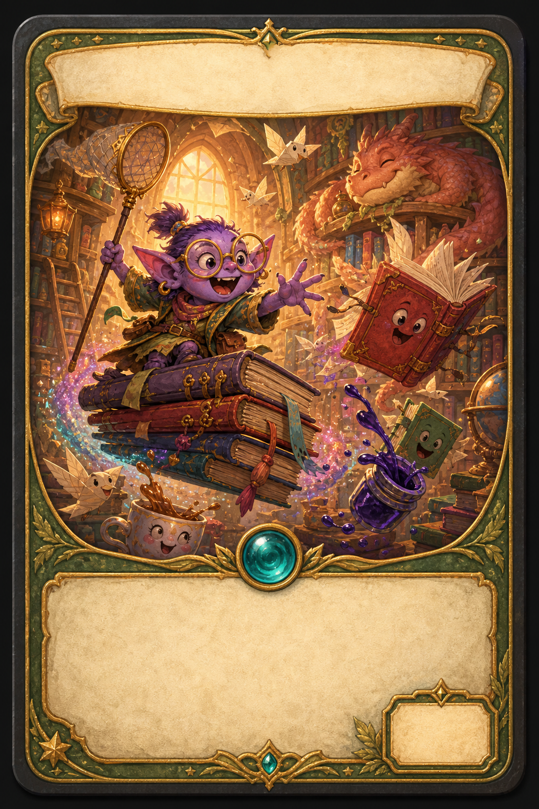

午夜十二点，档案馆的门自己打了个哈欠。

值夜员本来只需要把书放回架子。直到第一枚亮晶晶的书签从《安静守则》里滑出来，第二枚插进他的帽子，第三枚落到桌面中央。

下一秒，书本自己翻开，茶杯排队鼓掌，地图卷成望远镜，认真检查每个人的鞋带。

值夜员举起登记簿：“每次只许发生一件事故。”

档案馆想了想，答应了。于是混乱变得很有礼貌：每次只咔哒一声，但谁也不知道下一次会跳出飞书、茶杯，还是一张夸大其词的地图。

清晨，馆长在门口发现一张值夜记录：

“一切正常。除了《安静守则》要求明天再办一次。”

这就是“捣蛋档案馆”：三枚书签是一句倒计时，把一次小差错变成大家都记得住的笑话。
