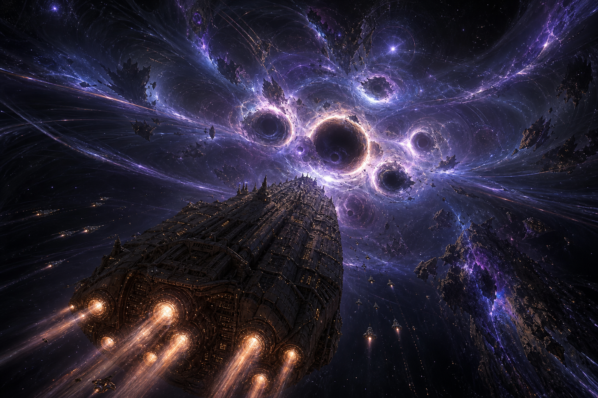

# 放逐者

有一个族群，生来具备穿越世界的能力，他们被誉为世界旅行者。

他们来自世界之间的缝隙，在空间风暴中诞生。残酷的环境赋予了他们穿梭世界的能力，同时也让他们失去了定居于世界内的能力。随着族群的壮大，一代又一代人搭建出星舰，飘荡在世界之外。许多在世界缝隙探索未知的冒险者会在这座星舰上落脚补给。久而久之，这座星舰也被称为最后的绿洲。

但自从永恒历28123年之后，再也没人见过这个族群了，每一个自世界缝隙归来的冒险者都因为没能找到绿洲而提前返航，最后的绿洲从此成为历史书上的一笔注脚。

而这一切都是因为一个世界旅行者，也是最后一个世界旅行者卡瓦隆。在永恒历28114年，卡瓦隆偶然来到一个面临末日的世界。这个世界由于核心在大战中被摧毁，正在收缩的过程中。卡瓦隆从家乡带来人造核心来临时补救这个世界，但在路上被一伙自称放逐者的团体偷袭抢走人造核心。

放逐者拿到人造核心后构建为多个不稳定的时空奇点，经过世界旅行者一族的计算，放任不管会导致多个世界被吞灭，并最终吞没整个宇宙。唯一解决的办法是使用人造核心在时空奇点的稳定带构建新的奇点以实现平衡，最终卡瓦隆驾驶着星舰走向了永恒。

放逐者仍然游荡在世界的缝隙中，想办法将这个世界放逐。
