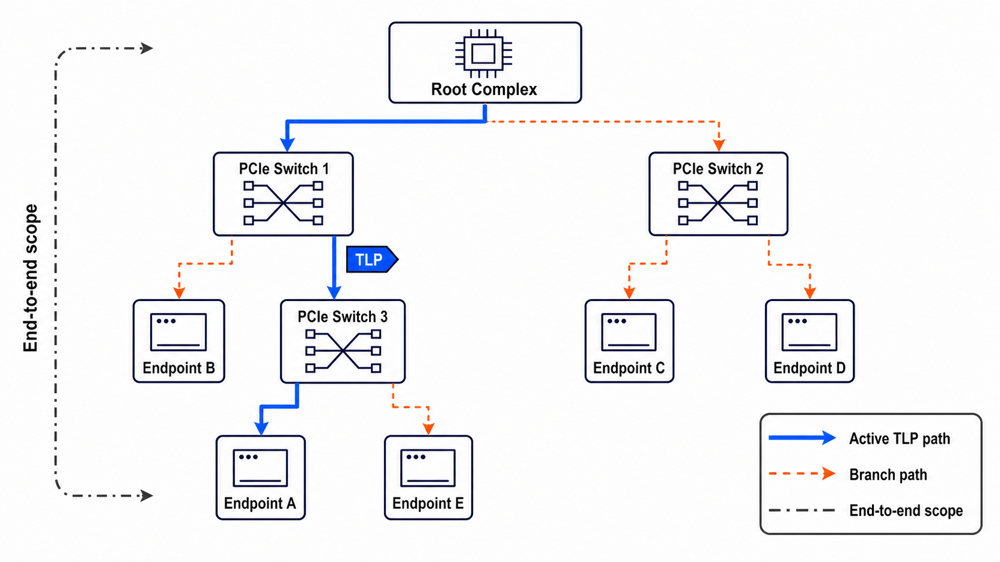
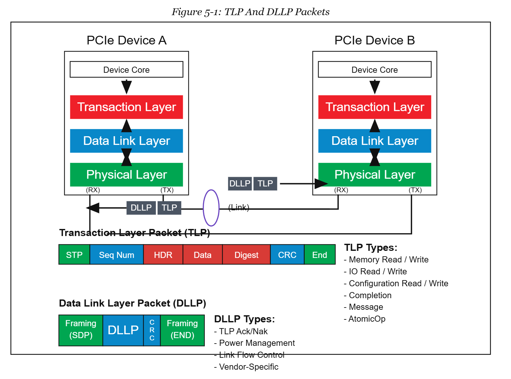

# PCIe 中 LCRC 与 ECRC 的区别

PCIe 同时使用 LCRC（Link CRC）和 ECRC（End-to-End CRC），但两者不是重复校验同一件事：LCRC 负责**逐跳链路的快速恢复**，ECRC 负责**源 Function 到最终接收 Function 的完整性检测**。本文以传统 Non-FLIT Mode 的 TLP/DLLP 封装为例说明。

## TLP 的传输模型

PCIe 采用由 Root Complex、Switch 和 Endpoint 组成的树状拓扑，相邻端口之间通过点对点 Link 连接。一份 TLP 从源 Function 到最终接收 Function 的过程属于**端到端（End-to-End）传输**；它可能经过一个或多个 Switch，因此一条端到端路径通常由多跳彼此独立的 Link 组成：



在一次事务中，发起请求的 Function 称为 **Requester**，负责构造并发送 Request TLP；处理该请求的 Function 称为 **Completer**。Requester 和 Completer 描述的是事务角色，而不是固定的设备类型。例如，Root Complex 和 Endpoint 在不同事务中都可能成为 Requester 或 Completer。

TLP Header 携带事务类型、长度、Requester ID、Tag，以及地址或目标 ID 等信息。Switch 需要读取这些路由相关字段，并根据 TLP 类型选择输出端口：Memory 和 I/O Request 通常采用地址路由，Configuration Request 和 Completion 通常采用 ID 路由，Message 可以采用隐式路由。Switch 只把 TLP 转发到匹配端口，而不是向所有分支广播。

从传输过程看，每一跳都有独立的数据链路层状态和流量控制。以传统 Non-FLIT Mode 为例，接收端口先检查本跳的 Sequence Number 和 LCRC；校验成功后，TLP 才进入 Switch 的转发路径，并在下一条 Link 具备足够接收缓冲区 Credit 时继续发送。发送端口会为下一跳重新添加 Sequence Number 并计算 LCRC，因此同一个 TLP 经过多跳时，每一跳的链路层封装彼此独立。

一个“事务”不一定只包含一个 TLP。Posted Request（例如 Memory Write）发送后通常不需要 Completion；Non-Posted Request（例如 Memory Read）则需要 Completer 返回 Completion，读取的数据还可能由多个 Completion with Data TLP 携带。因此，Request TLP 和对应的 Completion TLP 方向可以相反，但它们共同组成一次完整事务。

Switch 通常不会处理普通 Memory 事务的 Payload，大部分事务层内容在转发过程中保持不变；不过，协议允许少数字段、TLP Prefix 或不同传输模式之间的 Header 在路由节点中发生合法处理。因此，不能把 TLP 理解为在所有节点间必然逐比特不变。总体上，LCRC 保护每一跳的传输，ECRC 则检查源 Function 到最终接收 Function 之间的端到端完整性。

## LCRC：逐跳链路校验与重传

链路循环冗余校验（LCRC, Link Cyclic Redundancy Check）是 PCIe 数据链路层用于检测**单跳**传输错误的校验码。一跳指一对相邻 PCIe 端口之间的传输；一份 TLP 即使跨越多个 Switch，也会被拆成多段独立的单跳传输。

LCRC 只在生成它的那条 Link 上有效。接收端发现 LCRC 错误时，会通过 ACK/NAK 和 Replay 机制要求发送端从 Retry Buffer 重传，因此错误能在出错 Link 附近被定位和恢复，而不用等到最终接收端才发现。

LCRC 之所以必须逐跳重算，并不是因为 Switch 一定会修改 TLP 内容，而是因为每个 Switch 端口都会终结上一段数据链路：接收端口校验并移除上一跳的 Sequence Number 和 LCRC，发送端口再为下一跳生成新的 Sequence Number 和 LCRC。LCRC 还保护这些链路层封装，因此不能由 ECRC 取代。

前面的 Sequence Number、LCRC、ACK/NAK 和 Replay 描述适用于传统 **Non-FLIT Mode**。PCIe 1.0 至 5.0 的 LCRC 核心机制基本一致；真正的结构性变化发生在 PCIe 6.0 引入 FLIT Mode 之后：

| PCIe 版本 | 链路封装与校验单位 | 错误恢复机制 | 核心变化 |
| :---: | :---: | :---: | :---: |
| 1.0 | 单个 TLP，携带 32-bit LCRC 与 Sequence Number | 按 TLP ACK/NAK、Replay | 建立传统逐 TLP 的链路层可靠性模型。 |
| 1.1 | 单个 TLP，携带 32-bit LCRC 与 Sequence Number | 按 TLP ACK/NAK、Replay | 延续 PCIe 1.0 的链路层机制。 |
| 2.0 | 单个 TLP，携带 32-bit LCRC 与 Sequence Number | 按 TLP ACK/NAK、Replay | 提升链路速率，LCRC 机制不变。 |
| 3.0 | 单个 TLP，携带 32-bit LCRC 与 Sequence Number | 按 TLP ACK/NAK、Replay | 改用 128b/130b 编码，LCRC 的逐跳语义不变。 |
| 4.0 | 单个 TLP，携带 32-bit LCRC 与 Sequence Number | 按 TLP ACK/NAK、Replay | 提升链路速率，LCRC 机制不变。 |
| 5.0 | 单个 TLP，携带 32-bit LCRC 与 Sequence Number | 按 TLP ACK/NAK、Replay | 提升链路速率，LCRC 机制不变。 |
| 6.0 | 固定 256B FLIT；FLIT 含 8B（64-bit）CRC | 按 FLIT NAK、Replay，并先进行 FEC 纠错 | 引入 PAM4、FLIT Mode 和 3-way interleaved FEC；TLP/DLLP 不再各自携带传统 CRC 字节。 |
| 7.0 | 延续 256B FLIT 与 8B（64-bit）CRC | 按 FLIT NAK、Replay，并配合 FEC | 延续 PCIe 6.0 的 FLIT Mode 可靠性模型，提升到 128 GT/s。 |

在 PCIe 6.0/7.0 的 FLIT Mode 下，接收端先对 FLIT 执行 FEC 解码，再检查 FLIT CRC；若仍然失败，则通过链路层重传恢复。PCIe 6.0 的 256B FLIT 中，前 242B 的 TLP/DLP 内容由 8B CRC 保护，整个 FLIT 再由 6B FEC 保护。

因此，本文的 TLP/DLLP 包格式图应理解为 Non-FLIT Mode 的示意。能够与旧版本互操作的 PCIe 6.0/7.0 链路仍可使用传统模式；一旦链路进入 FLIT Mode，即使用 FLIT 级 CRC、FEC 和重传机制。ECRC 仍属于事务层的端到端完整性机制，不应与 FLIT CRC 混为一谈。

## ECRC：端到端完整性检测

端到端循环冗余校验（ECRC, End-to-End Cyclic Redundancy Check）在 **Non-FLIT Mode** 下由 TLP 发送端生成，并放入 TLP 的 Digest 字段。它随着 TLP 穿越整条 Fabric，由最终接收端检查，用于发现逐跳 LCRC 无法覆盖的端到端错误。

中间 Switch 通常不是该 TLP 的最终接收者，因此主要完成本跳 LCRC 校验和路由转发；如果 TLP 的目标正是 Switch 自身的 Function，它才作为最终接收者检查 ECRC。对于协议允许沿途变化的字段，ECRC 计算规则会进行相应处理，从而避免合法修改导致误报。

一般来说，ECRC 覆盖跨 Fabric 转发时不应改变的 TLP 事务层内容，基本包括：

- 大部分 TLP Header 字段：
  - Fmt / Type：TLP 格式和类型，但 Type[0] 是特殊可变字段，计算时按规则处理。
  - TC：Traffic Class。
  - Attr：事务属性。
  - TH / TD / EP 等控制位，其中 EP 是特殊可变字段。
  - Length：Payload 长度。
  - Requester ID。
  - Tag。
  - Last DW BE / First DW BE。
  - Address：Memory / I/O Request 中的地址字段。
  - Completer ID：Completion TLP 中的完成方 ID。
  - Status / BCM / Byte Count / Lower Address：Completion Header 中的字段。
  - Message Code：Message TLP 中的消息类型字段。
- End-End TLP Prefix。
- Data Payload。

不同 TLP 类型和 PCIe 版本的精确覆盖方式应以对应版本规范为准。Sequence Number、LCRC 和 DLLP Framing 等数据链路层内容不属于 ECRC 覆盖对象。

从包格式上看，ECRC 对应 TLP 中的 Digest 字段；Sequence Number 和 LCRC/CRC 属于链路层封装，只在相邻两个端口之间有效：



ECRC 的核心目的是让最终接收端检测 TLP 是否在端到端传输中发生了**非预期损坏**。它不是加密或访问控制机制：普通 PCIe Switch 为了路由可以读取必要的 Header 字段，普通 PCIe 也不会因为存在 ECRC 而隐藏 Payload。CRC 不是带密钥的认证码，不能抵御恶意节点有意修改 TLP 后重新计算校验值；需要保密性、抗篡改或抗重放保护时，应使用 PCIe IDE 等安全机制。

ECRC 的实现能力始终是可选的；后续版本并没有要求所有 PCIe 设备必须实现 ECRC。变化主要体现在 PCIe 2.1 对已支持、已启用 ECRC 的行为提出了更明确的统一要求，以及 PCIe 6.0 对 Non-FLIT 与 FLIT Mode 的区分：

| PCIe 版本或模式 | ECRC 规则 | 关键影响 |
| :---: | :---: | :---: |
| 1.0 | ECRC 是可选的事务层能力，以 TD bit 和 TLP Digest 表示。 | 系统可以只依赖逐跳 LCRC。 |
| 1.1 | ECRC 是可选的事务层能力，以 TD bit 和 TLP Digest 表示。 | 延续 PCIe 1.0 的 ECRC 规则。 |
| 2.0 | ECRC 是可选的事务层能力，以 TD bit 和 TLP Digest 表示。 | 延续 PCIe 1.1 的 ECRC 规则。 |
| 2.1 | ECRC 仍是可选能力；启用生成后，必须对该 Function 发出的所有 TLP 应用 ECRC；启用检查后，必须检查所有目标为该设备且携带 ECRC 的 TLP。 | 避免设备只对部分 TLP 类型生成或检查 ECRC。 |
| 3.0 | 延续 PCIe 2.1 的 ECRC 可选性与启用后规则。 | ECRC 规则不因 128b/130b 编码而改变。 |
| 4.0 | 延续 PCIe 2.1 的 ECRC 可选性与启用后规则。 | ECRC 规则保持不变。 |
| 5.0 | 延续 PCIe 2.1 的 ECRC 可选性与启用后规则。 | ECRC 规则保持不变。 |
| 6.0 Non-FLIT Mode | 延续传统 TD bit 和 TLP Digest 的 ECRC 规则。 | 本文关于 Digest、字段覆盖和最终接收端检查的说明适用于此模式。 |
| 6.0 FLIT Mode | TLP Digest/ECRC 规则被定义为 Non-FLIT Mode Only，不使用传统 TLP Digest ECRC。 | FLIT CRC 与 FEC 提供 FLIT 级链路可靠性，但不能把 FLIT CRC 直接当作传统 ECRC。 |
| 7.0 Non-FLIT Mode | 延续传统 TD bit 和 TLP Digest 的 ECRC 规则。 | 与 PCIe 6.0 Non-FLIT Mode 的 ECRC 规则一致。 |
| 7.0 FLIT Mode | 不使用传统 TLP Digest ECRC。 | 延续 PCIe 6.0 的 FLIT CRC 与 FEC 机制。 |

换言之，PCIe 6.0/7.0 的 **FLIT CRC 不是 ECRC 的同名替代品**：前者按 FLIT 保护每一跳链路，后者是 Non-FLIT Mode 中按 TLP 携带的端到端校验。对于需要端到端安全属性的场景，还应结合 PCIe IDE 等机制评估。


## 为什么同时需要 LCRC 与 ECRC

以下流程仅适用于传统 Non-FLIT Mode，并假设源 Function 已启用 ECRC 生成、最终接收 Function 已启用 ECRC 检查：

```text
源 Function：计算 ECRC 并写入 Digest -> 添加 Sequence Number -> 计算本跳 LCRC
中间 Switch：校验本跳 LCRC -> ACK/NAK 与必要时 Replay -> 移除旧链路层封装
             -> 路由转发 -> 添加下一跳 Sequence Number 和新的 LCRC
最终接收端：校验最后一跳 LCRC，并检查 ECRC/Digest
```

可以把它类比为长途运输中的两层质检：每个中转站检查本段运输单据，发现损坏就立即要求上一站补发；收货方则根据货物清单核对货物的端到端校验记录，确认整段旅程后内容仍正确。运输单据对应 LCRC、ACK/NAK 和 Replay，货物清单则对应 ECRC。

| 维度 | LCRC | ECRC |
| --- | --- | --- |
| 保护范围 | 一条 Link | 源 Function 到最终接收 Function |
| 所在层次 | Data Link Layer | Transaction Layer |
| 生成与校验 | 每一跳端口生成、校验并重算 | 源端生成，最终接收端检查 |
| 错误后的主要动作 | ACK/NAK、Replay 重传 | 报告端到端完整性错误 |
| 能否保密或防御恶意篡改 | 不能 | 不能 |

LCRC 和 ECRC 不是替代关系。LCRC 负责定位并恢复单跳链路错误；ECRC 负责在最终目的地发现中间节点内部或多跳路径上遗留的端到端错误。两者都属于可靠性机制，而不是保密机制。

## 只使用一种校验会怎样

### 只有 ECRC

ECRC 可以让最终接收端发现端到端内容不一致，中间 Switch 也可以选择检查经过的 ECRC；但它不能替代链路层的 ACK/NAK 和 Replay。若假设没有 LCRC 或等效的 FLIT CRC，主要后果是：

- 错误通常只能在最终接收端或某个可选检查点才被发现，无法在出错 Link 附近快速恢复。
- 无法依据 ECRC 失败定位具体是哪一跳 Link 出错。
- 不存在与本跳发送端 Retry Buffer 配套的标准逐跳重传，因此恢复延迟和影响范围都会扩大。

因此，ECRC 适合做端到端兜底检测，而不是单独承担 PCIe 的链路可靠性职责。

### 只有 LCRC

在传统 Non-FLIT Mode 下，只有 LCRC 时 PCIe 仍可快速校验每一条 Link 并执行 ACK/NAK 和 Replay；这也是 ECRC 保持可选的原因。但此时系统缺少端到端完整性检测，下列问题可能不会被发现：

- Switch 在入端 LCRC 校验成功后，其内部缓冲或转发路径意外改坏 TLP；出端会基于已损坏的内容重算新的、正确的 LCRC。
- TLP 在源端进入第一条 Link 前，或在最终接收端完成最后一跳 LCRC 校验后，经过了发生错误的内部数据通路。
- Link 传输错误以极低概率发生 CRC aliasing，恰好未改变 LCRC 结果。
- 异常或恶意中间设备修改 TLP 后重新计算下游 LCRC；普通 CRC 不带密钥，不能防止这种有意篡改。

### LCRC 全部通过但 ECRC 检查失败

该现象的前提是 ECRC 已生成并启用检查。它表示各跳 Link 上接收到的比特流都通过了本跳 LCRC 校验，但源端生成 ECRC 后、最终接收端检查 ECRC 前，TLP 的端到端内容出现了不一致。常见排查方向包括：

- **Switch 内部缓冲或转发路径错误**：入端 LCRC 校验成功后，TLP 在 Switch 内部被意外改坏；出端又基于已损坏的 TLP 重算了正确的 LCRC。
- **源端 ECRC 生成或发送路径错误**：例如 Digest 计算逻辑错误，或 ECRC 生成后、进入第一条 Link 前 TLP 内容发生改变。
- **最终接收端接收或检查路径错误**：最后一跳 LCRC 已验证链路传输正确，但接收端在 ECRC 检查前的数据通路或检查逻辑发生错误。
- **可变字段处理不一致**：对 Type[0]、EP、TLP Prefix 等具有特殊规则的字段处理不符合规范，导致发送端和接收端参与 ECRC 的内容不一致。
- **Link 错误被 LCRC 漏检**：CRC 存在极低概率的 aliasing；此时传输错误恰好未改变 LCRC 结果，仍可能由 ECRC 暴露。

在多级拓扑中，Switch 内部转发路径通常是重点排查对象；但还应结合 ECRC/LCRC 错误计数、AER 日志和缩短拓扑后的复现结果，区分源端、Switch 与最终接收端的问题。

在传统 Non-FLIT Mode 中，LCRC 是链路层可靠性机制；在 PCIe 6.0/7.0 的 FLIT Mode 中，则由 FLIT CRC、FEC 和按 FLIT 重传承担对应职责。ECRC 仍然是可选能力，缺少它不会阻止 PCIe 的基本链路传输，但会降低端到端错误检测覆盖。

## 总结
- LCRC 是逐跳、可重传的链路层校验；每经过一个 Switch 都会被终结并重新生成。
- 在 Non-FLIT Mode 中，ECRC 是携带在 TLP Digest 中的端到端校验；它跨越多个 Link，通常由最终接收端检查。
- LCRC 会覆盖本跳传输中的 ECRC/Digest 字段，因此能够保护 ECRC 本身在单跳链路上不被传输错误破坏。

## References

- [PCI-SIG: PCI Express Base Specification](https://pcisig.com/specification-overview/pci-express-base)
- [PCI-SIG: PCIe for Automotive Functional Safety](https://pcisig.com/sites/default/files/files/PCI-SIG%20PCIe%20for%20Automotive%20Functional%20Safety_v5_Final.pdf)
- [PCI-SIG: The Evolution of the PCI Express Specification](https://pcisig.com/blog/evolution-pci-express-specification-its-sixth-generation-third-decade-and-still-going-strong)
- [PCI-SIG FAQ: ECRC checking by the ultimate PCI Express Receiver](https://pcisig.com/section-53141-root-port-connected-multifunction-endpoint-root-port-ecrc-capable-multifunction)
- [DMTF DSP0238: MCTP PCIe VDM Transport Binding](https://www.dmtf.org/sites/default/files/standards/documents/DSP0238_1.0.pdf)
