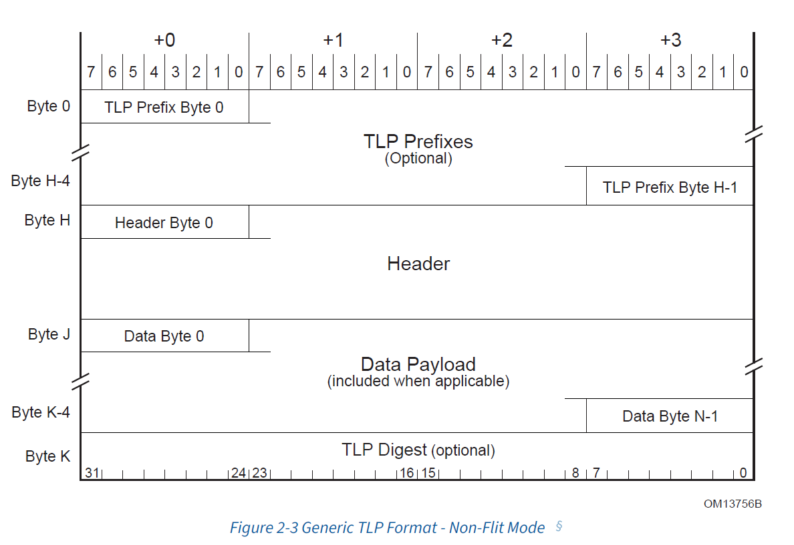
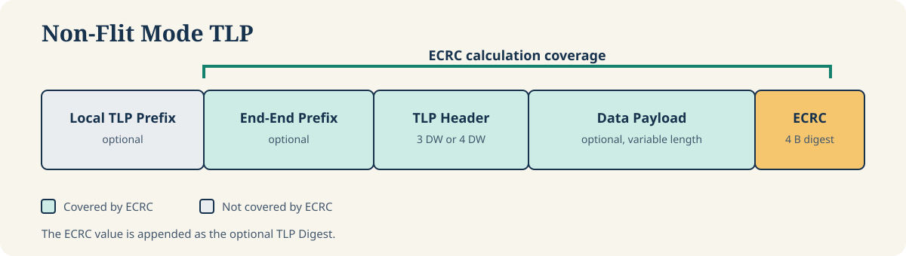
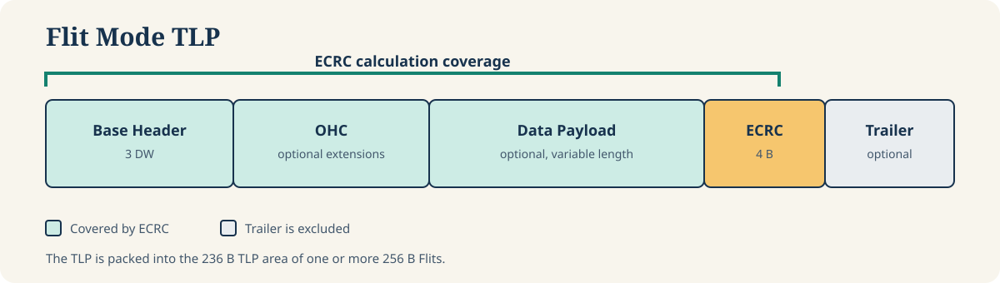
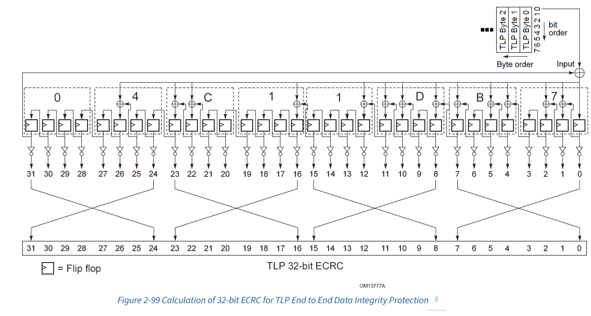
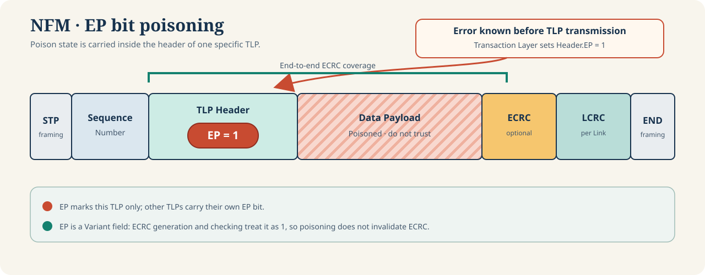
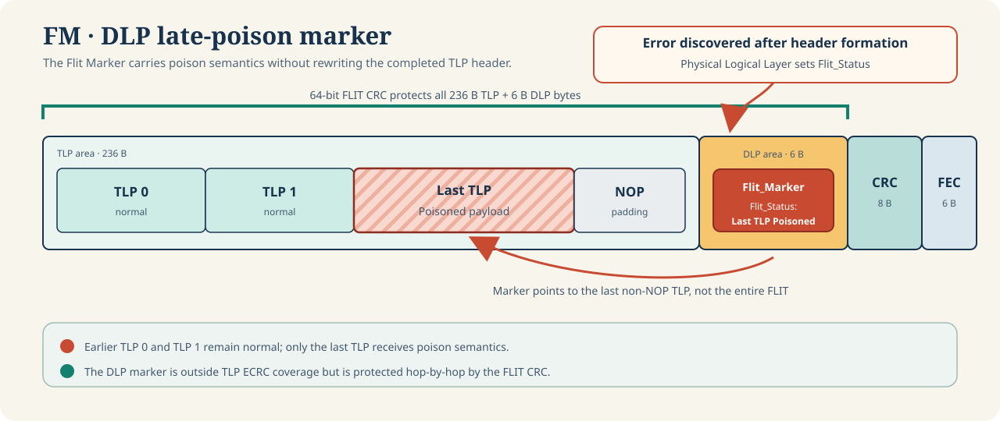

## 1 ECRC Rules

ECRC功能的启用与否是由软件配置而成的，软件通过配置空间确认硬件是否支持ECRC生成与检查，同时可以配置是否开启ECRC生成与检查功能。

在ECRC启用的情况下，必须要满足以下规则：

- 如果一个Function能够生成ECRC，那么所有由该Function生成的TLP都必须要执行ECRC操作
- 对于不需要进行FM/NFM translation的非加密TLP(non-IDE TLP)事务而言，交换节点必须在ECRC不变的情况下让TLP通过（从输入端到输出端不做变更，只做路由）
  - 对于IDE TLPs而言，ECRC规则失效。因为IDE本身具备端到端的完整性检查能力。同时IDE是为了保证数据安全而产生的，若IDE与ECRC同时生效，则ECRC必须在IDE完成后进行计算，计算效率较低。因此在规定中，两者相互排斥。
  - 同样的，出于安全考虑，IDE TLPs同样不会发生FM/NFM的转换。主要原因是FM/NFM需要对TLP进行重新封装，这会要求IDE TLP暴露原始数据，违背加密要求。而Non-IDE TLPs则无此安全要求，因此可以进行FM/NFM的转换。

- 如果一个设备支持ECRC生成与检查，那么他的Function中至少要有一个支持高级错误报告(Advance Error Reporting, AER)功能
- 如果一个设备支持ECRC检查，而且是端节点，那么他必须对所有以其为目标且具有ECRC的TLP包进行检查

notes：

- non-IDE TLP：未使用 PCIe IDE 进行完整性保护或加密的普通 TLP。
- FM/NFM translation：当入口与出口链路分别工作在 Flit Mode 和 Non-Flit Mode 时，交换节点对 TLP 格式进行的转换。
- AER：PCIe 的扩展错误报告能力，用于记录、分类并上报可纠正和不可纠正错误；ECRC 检查失败可通过 AER 报告，由系统软件据此定位故障并执行恢复。

## 2 how to generate

### 2.1 覆盖范围

``` PCIE 7.0 spec
A 32-bit ECRC is calculated for the TLP (End-End TLP Prefixes/OHC, header, and data payload), but not, in FM, including
any Trailer, using the following algorithm and appended to the end of the TLP
```



从官方文档的描述可以看出来，ECRC的覆盖范围包括header扩展部分，header本体以及数据载荷，可以理解为switch不更改的部分都会被ECRC覆盖。
在协议中，TLP中不会被switch所modified的字段就是ECRC覆盖的范围（除了digest部分）。

对于TLP而言，主要组成包括：

- Non-Flit Mode TLP



在 Non-Flit Mode 中，ECRC 以 4 Byte TLP Digest 的形式附加在 TLP 末尾。计算范围包括 End-End TLP Prefix、TLP Header 和 Data Payload；Local TLP Prefix 不参与 ECRC 计算。

- Flit Mode TLP



在 Flit Mode 中，ECRC 计算覆盖 Base Header、OHC 和 Data Payload，计算结果附加在 TLP 尾部；可选 Trailer 不参与 ECRC 计算。TLP 随后被装入一个或多个 FLIT 的 TLP 区域，FLIT CRC 与 FEC 则负责逐跳链路保护。

在NFM中存在local-prefix，这是明确规定不参与ECRC计算的字段：``Local TLP Prefixes (if present) are not included in the ECRC calculation.``

### 2.2 实现算法



Todo：硬件实现原理

### 2.3 串行计算方式

### 2.4 并行计算方式

## 3 how to check

NFM和FM两种模式下ECRC被放置在不同的位置，NFM情况下ECRC被放置于TLP Digest字段，FM情况下被放置于TLP trailer字段。

接收端如果支持ECRC check，则会按照ECRC generate的方式重新计算ECRC值，并与TLP Digest/trailer传递的ECRC值进行对比。如果相等则传输过程无误，否则被认为是ECRC Error。

在上报错误时，错误数据会与错误tlp传入的port所关联：``Receivers that support end-to-end data integrity checks report violations as an ECRC Error. This reported erroris associated with the Receiving Port``

最后，spec还提出几个需要注意的地方：
``Beyond the stated error reporting semantics contained elsewhere in this specification, how ultimate PCI Express
Receivers make use of the end-to-end data integrity check provided through the ECRC is beyond the scope of this document. Intermediate Receivers are still required to forward TLPs whose ECRC checks fail. A PCI Express-to-PCI/PCI-X
Bridge is classified as an ultimate PCI Express Receiver with regard to ECRC checking.``

### 3.1 Ultimate Receiver 与 Intermediate Receiver

**Ultimate Receiver** 是 TLP 的最终接收者，事务会在该 Function 终止并被实际处理。它在启用 ECRC Check 后负责重新计算 ECRC，并将结果与 TLP 携带的 ECRC 比较；若检查失败，则按照 ECRC Error 的规则记录和上报错误。规范只定义检查与上报语义，并不规定最终接收者必须丢弃 TLP、复位设备或通知应用程序，具体恢复策略由设备实现、驱动程序和上层协议决定。

**Intermediate Receiver** 是路径中的中间接收者，例如负责路由转发的 PCIe Switch Port。即使它检查到 ECRC 错误，也不能仅因为 ECRC 失败而停止转发该 TLP，仍需将其送往最终接收者。这样可以保证端到端检查在真正的事务终点完成，避免中间节点提前丢弃 TLP，使最终接收者失去错误记录和处理机会。若该 TLP 同时存在 Malformed TLP、路由失败等其他错误，则应分别按照对应规则处理。

### 3.2 ECRC Error 与链路重传

ECRC 属于端到端完整性检查，不参与 Data Link Layer 的 ACK/NAK 和 Replay。ECRC 检查失败不会自动要求上一跳重新发送 TLP，因为每一跳的 LCRC 或 FLIT CRC 可能都已经检查成功。接收端通常通过 AER 中的 ECRC Check Failed 状态记录并上报错误，错误与检测到该问题的 Receiving Port 关联。

因此，Receiving Port 表示**发现错误的位置**，不一定是**产生数据破坏的位置**。错误可能来自源 Function 内部、某个 Switch 的 Buffer 或转发路径，也可能来自最终接收端在执行 ECRC Check 之前的内部数据通路，需要结合各跳链路错误计数、AER 日志和拓扑隔离进一步定位。

### 3.3 PCIe-to-PCI/PCI-X Bridge

PCIe-to-PCI/PCI-X Bridge 在 ECRC 语义上被视为 Ultimate Receiver。原因是 PCI/PCI-X 侧不能继续传递 PCIe TLP 及其 ECRC，端到端保护范围必须在协议转换边界终止。因此 Bridge 应在 PCIe 侧完成 ECRC 检查和错误上报，再按照 PCI/PCI-X 的报文与错误处理规则继续事务。

整体处理流程可以概括为：

```text
源 Function 生成 ECRC
        ↓
中间 Switch 转发 TLP；ECRC 失败本身不能阻止转发
        ↓
Ultimate Receiver 检查 ECRC
        ├─ 通过：正常处理 TLP
        └─ 失败：记录并上报 ECRC Error，后续恢复由实现决定
```

### 3.4 TD

reciver决定是否额外取1DW作为TLP Digest的依据是Header中的TD字段，因此switch需要注意保护TD字段，避免其出现翻转导致reviver遗漏ECRC字段

### 3.5 EP

在TLP传输中有一个特殊情况，发送端知道手中的数据是错误的，但仍然会执行发送，将错误数据的处理方式交由接收端决定。

这种特殊情况被称为Error Forwarding，或者说是Data Poisoning。触发的条件是发送端通过某种方式知道这个事务数据是错误的，那么他会按照正常TLP发送的流程进行打包，但将EP字段拉高，表示当前TLP是error forwarding状态。

#### 3.5.1 错误来源与发现机制

| 错误来源 | 发送端如何发现 | 典型处理方式 |
| --- | --- | --- |
| Memory 或 Cache 中存在不可纠正 ECC 错误 | ECC Decoder 根据 Syndrome 判断错误超过纠正能力 | 返回 Completion with Data 或发送 Memory Write 时设置 `EP=1` |
| 设备内部 SRAM、Replay Buffer 或 Queue 数据损坏 | SRAM ECC、Parity 或内部 CRC 检查失败 | 若仍需转发对应数据，则在输出 TLP 中设置 `EP=1` |
| 芯片内部 Data Path、NoC 或 CDC 通路发生错误 | Data Path Parity、端到端 ECC 或内部 Poison Sideband 指示错误 | 将内部 Poison 状态映射到输出 TLP 的 EP 字段 |
| 上游已经发送 Poisoned TLP | 接收端解析 TLP Header 时发现 `EP=1` | 不将 Payload 当作可信数据；继续转发或生成相关数据时传播 Poison 状态 |
| Device Core 或应用逻辑发现源数据无效 | 设备自定义错误状态、ECC 中断或数据有效性检查失败 | 在提交给 PCIe Controller 时同时给出 Data Poison 标志 |

最典型的场景是 Completer 处理 Memory Read Request 时，从目标 Memory 中读到了不可纠正的 ECC Error。此时地址和事务本身仍然有效，Completer 可以返回 Completion with Data，但需要设置 `EP=1`，使 Requester 知道返回的数据不可使用。类似地，Endpoint 执行 DMA Write 时，如果本地 Buffer 已经被内部 ECC 标记为不可恢复，也可以发送设置 EP 的 Memory Write TLP。

并不是所有错误都会触发 Data Poisoning。如果当前 Link 上发生随机传输误码，应由 LCRC 或 FLIT CRC 检测并通过 Replay 恢复；如果最终接收端发现 ECRC 不匹配，应报告 ECRC Error。只有组件在发送 TLP 前已经知道其 Payload 不可靠，但仍需要保留事务上下文并继续传递时，才使用 `EP=1`。如果事务无法执行且没有有效数据可以返回，通常应通过 Completion Status（例如 UR 或 CA）报告，而不是构造 Poisoned Data。

#### 3.5.2 Error Forwarding 机制

首先是error forwarding的适用范围，根据spec：

``` PCIE spec 7.0
Error Forwarding is only used for Read Completion Data, AtomicOp Completion Data, AtomicOp Request Data,
or Write Data, never for the cases when the error is in the “header” (request phase, address/command, etc.).
```

也即，如果tlp的header错误，那么这个tlp会被丢弃、重传或按照协议错误处理，而不会被error forwarding。根本原因是在真实目的地未知的情况下，如果贸然传递错误header，可能会导致错误数据覆盖或写入的错误，进而导致系统崩溃，因此不会被采取error forwarding的方式传递。

**question 1**：为什么不设置ep来让接收端知道该tlp不可信？
因为接收端虽然通过ep确认该事务不可信，但不同的endpoint会采取不同的操作，比如将错误数据进行某个算法修复后写入mem。但在header错误的情况下，这段数据的destination并不能确定为该接收端，因此写入会导致错误的数据覆盖。为了避免这一情况，协议规定header错误不允许进行error forwarding

**question 2**：error forwarding是否会导致link layer retry？
答案是不会，因为link layer retry触发的原因是链路损坏导致数据错误。而error forwarding的错误原因是数据来源本身的错误，与链路无关。因此link layer retry并不会被触发。

**question 3**：为什么要设计error forwarding这个机制？
因为pcie协议的核心思想是高带宽传递数据，保证每个事务都能被可靠的交付。因此数据本身的错误并不在pcie协议考虑的范围内，数据事务的可靠交付才是最重要的。如果选择丢弃error forwarding包，可能会导致接收端一直等待，形成死锁。因此从完成交付角度出发，错误数据仍然会被打包发送，并设置不可信标志位，让接收端决定如何处理。这其实表明协议的思想是，专注于高带宽的数据交付，非链路导致的数据异常交由frabic决定如何处理，形成功能上的解耦。

error forwarding的使用在spec中有着详细规定：

- 只能用于payload有效的tlp中

```text
Data poisoning applies only to the data payload 61 within a Write Request (Posted or Non-Posted), a Message with Data, an AtomicOp Request, a Read Completion, or an AtomicOp Completion.
```

- 事务层通过EP字段来标记该TLP的payload是否可信
- NFM/FM跨节点时，EP位置必须保持不变，不论是从NFM到FM还是FM到NFM
- 对于发送端(transmitter)而言，只允许对带有payload的tlp执行poisioning；在NFM模式下，对于接收端(receiver)而言，如果带有ep标志的tlp不具备payload，则协议对其操作无特殊要求。
- 对于IDE TLP而言，不允许switch对tlp进行ep修改，因为这会违反IDE的数据安全要求。同样的，在FM下，也不允许pllb进行poision处理，这一操作等效于修改IDE TLP的语义要求

#### 3.5.3 Physical Layer Logical Block机制

在FM下，还有第二个data posioning处理机制，Physical Layer Logical Block，来作为TLP发送前的最后一道屏障。

Physical Layer Logical Block是相对于Error Forwarding发现时间较晚的data poisioning处理措施。error forwarding会在TLP组包前识别出数据错误，而pllb则是在tlp组包完成后发现错误。pllb的主要作用是避免tlp在发现错误后因为无法修改ep而需要重新计算，通过在FLIT中的DLP字段来标记该Flit中最后一个tlp是poisioned tlp。

出于接收端的缓存考虑，dlp只标识该flit中的最后一个tlp是poisioned。这一设计的核心原因在于，该机制的核心在于处理晚发现的错误，而非索引错误的tlp位置，同时固定标识末位tlp为poisioned便于接收端缩小缓存buffer空间，这样子接收端只需要固定缓存最后一个tlp，在检查DLP无poisioned错误时再释放即可，可以减少大量无效缓存空间。

#### 3.5.4 两个机制之间的关系

EP bit与Physical Layer Logical Block机制表达的是相同的Data Poisoning语义：TLP本身仍然是一个有效事务，但其Payload不可信。两者的区别主要在于标记所在的层次和错误被发现的时间。EP位于TLP Header中，适用于Transaction Layer在构造或发送TLP前已经知道Payload错误的情况，并且可以在FM和NFM中使用；Physical Layer Logical Block通过FLIT的DLP字段携带`Flit_Status = Last TLP Poisoned`，只适用于FM，主要处理Header已经形成后才发现的晚期错误。



如果发送端支持Data Poisoning，并且Transaction Layer已经知道Payload错误，则必须使用EP bit，而不能用Physical Layer Logical Block机制代替。Physical Layer Logical Block更接近发送路径的最后补救措施，它不修改已经形成的TLP Header和ECRC，只把当前FLIT中的最后一个TLP标记为Poisoned。接收端对两种标记的基本处理语义相同，都会将对应TLP的Payload视为不可信。



当Poisoned TLP跨越不同模式的链路或经过路由节点时，Poison状态需要继续传播。FM转换为NFM时，由于NFM不存在`Flit_Status`，Physical Layer Logical Block的Poison标记必须转换为对应TLP的`EP=1`；NFM转换为FM时，原有的EP Poison语义继续保留。对于IDE TLP，只允许原始发送端使用EP bit进行Poison，不能使用Physical Layer Logical Block机制。

| 对比项 | EP bit机制 | Physical Layer Logical Block机制 |
| --- | --- | --- |
| 标记位置 | TLP Header | FLIT的DLP字段中的`Flit_Status` |
| 适用模式 | FM和NFM | 仅FM |
| 错误发现时间 | TLP构造或发送前 | Header形成后的发送路径中 |
| 标记对象 | 当前TLP | FLIT中的最后一个TLP |
| 是否修改TLP | 设置TLP Header中的EP | 不修改TLP，通过FLIT元数据传递Poison语义 |
| FM到NFM转换 | 保持`EP=1` | 转换为`EP=1` |

#### 3.5.5 TLP Nullify机制

如果发送端已经开始发送TLP，之后才发现该TLP无法继续有效交付，则可以使用TLP Nullify（TLP作废）机制，通知接收端丢弃整个TLP。Nullified TLP与Poisoned TLP的语义不同：Nullified表示整个TLP被撤销，不构成有效事务；Poisoned则表示事务及TLP结构仍然有效，但其中的Payload不可信。

在NFM中，发送端使用`EDB`代替正常的`END`结束符，同时发送与正常传输值逐位相反的LCRC。这里的“相反”是指对32-bit LCRC逐位取反，而不是改变字节顺序或反转CRC多项式。假设正常发送的LCRC为`C`，则Nullify时发送的LCRC为：

```text
nullified_LCRC = C XOR 0xFFFFFFFF
```

例如，正常LCRC为`0x12345678`时，Nullify使用的LCRC为`0xEDCBA987`。接收端看到`EDB`后，会按照Nullified TLP的特殊规则检查该反相LCRC；检查通过说明这是发送端有意撤销TLP，而不是普通链路误码。对应地，`正常LCRC + END`表示正常TLP，`反相LCRC + EDB`表示Nullified TLP，若LCRC与结束符的组合不符合规则，则按传输错误处理。

在FM中不存在`END/EDB`包结束符，等价的作废语义通过DLP中的`Flit_Status = Last TLP Nullified`表示。Nullify本身只负责撤销当前TLP，是否重新构造并发送`EP=1`的TLP，取决于错误类型和设备实现。

#### 3.5.6 接收端处理方式

Poisoned TLP 的 Header、Payload 和链路 CRC 在格式上仍然可以完全正确。接收端不是通过重新计算数据内容来判断 Poison，而是在解析 TLP Header 时直接检查 EP 字段：

```text
接收并通过 LCRC/FLIT CRC 检查
        ↓
解析 TLP Header.EP
        ├─ EP=0：按照普通 TLP 继续处理
        └─ EP=1：Payload 被标记为不可信
                     ↓
              记录 Poisoned TLP Received
                     ↓
              通过 AER/错误消息通知系统
```

支持 AER 的接收 Function 会在检测到 Poisoned TLP 后设置 `Poisoned TLP Received` 状态，并根据 Error Mask、Severity 和 Reporting Enable 配置决定是否发送错误消息。AER 能指出哪个 Receiving Port 发现了 Poisoned TLP，但仅凭 EP 位无法确定数据最初在哪里损坏，还需要结合源设备 ECC 日志、各级 Switch AER 状态和平台 RAS 记录进一步定位。

## 4 summary

## 5 reference

[1] NCB_PCI_Express_Base7.0, Section 2-7
