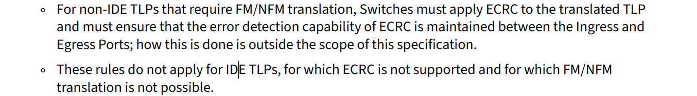

## 1 ECRC Rules

ECRC功能的启用与否是由软件配置而成的，软件通过配置空间确认硬件是否支持ECRC生成与检查，同时可以配置是否开启ECRC生成与检查功能。

在ECRC启用的情况下，必须要满足以下规则：

- 如果一个Function能够生成ECRC，那么所有由该Function生成的TLP都必须要执行ECRC操作
- 对于不需要进行FM/NFM translation的非加密TLP(non-IDE TLP)事务而言，交换节点必须在ECRC不变的情况下让TLP通过（从输入端到输出端不做变更，只做路由）
  - 对于IDE TLPs而言，ECRC规则失效。因为IDE本身具备端到端的完整性检查能力。同时IDE是为了保证数据安全而产生的，若IDE与ECRC同时生效，则ECRC必须在IDE完成后进行计算，计算效率较低。因此在规定中，两者相互排斥。
  - 同样的，出于安全考虑，IDE TLPs同样不会发生FM/NFM的转换。主要原因是FM/NFM需要对TLP进行重新封装，这会要求IDE TLP暴露原始数据，违背加密要求。而Non-IDE TLPs则无此安全要求，因此可以进行FM/NFM的转换。

- 如果一个设备支持ECRC生成与检查，那么他的Function中至少要有一个支持高级错误报告(Advance Error Reporting, AER)功能
- 如果一个设备

notes：

- non-IDE TLP：未使用 PCIe IDE 进行完整性保护或加密的普通 TLP。
- FM/NFM translation：当入口与出口链路分别工作在 Flit Mode 和 Non-Flit Mode 时，交换节点对 TLP 格式进行的转换。
- AER：PCIe 的扩展错误报告能力，用于记录、分类并上报可纠正和不可纠正错误；ECRC 检查失败可通过 AER 报告，由系统软件据此定位故障并执行恢复。

## 2 how to cal

## 3 fast generate

## 4 summary

## 5 reference

[1] NCB_PCI_Express_Base7.0, Section 2-7
