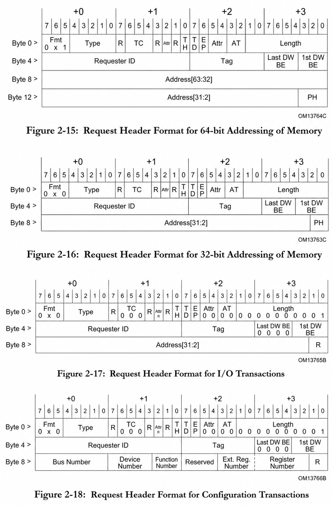

## 1 TLP

事务层报文(Transaction Layor Package, TLP)，是PCIE在事务层进行数据传输的主要报文

## 2 Structure

TLP可以被划分为三个部分：

- Header：由Device Core生成，一般3-4个DWs，事物的控制信息，用于Fabric正确识别、路由和处理该TLP
- Payload：由Device Core生成，为1~1024 DWs，事务的实际传输数据
- Digest/ECRC：可选部分，根据Header与Payload的数据计算得出，用于End-to-End 数据校验

*图：PCIe Memory、I/O 与 Configuration Request TLP Header 格式。*

### 2.1 Header

不同 TLP 类型复用同一组 Header DW，但字段含义并不完全相同。下表列出常见字段；`DW0` 表示 Header 的第一个 32-bit 字，`DWn[msb:lsb]` 表示字段的 Bit 位置。具体位宽和是否存在应以对应 TLP 类型及 PCIe 版本规范为准。

| 字段 | 典型 Bit 位置 | 作用 | 常见适用 TLP |
| --- | --- | --- | --- |
| Fmt / Type | `DW0[31:29]` / `DW0[28:24]` | 标识 TLP 的格式与事务类型，例如 Memory、I/O、Configuration、Completion 或 Message；`Fmt` 同时指示是否携带 Payload、Header 为 3DW 还是 4DW。 | 所有 TLP |
| TC (Traffic Class) | `DW0[22:20]` | 指定事务服务等级，供 Fabric 实施服务质量与虚拟通道映射。 | 所有 TLP |
| Attr | `DW0[18]`、`DW0[13:12]` | 携带事务属性，例如 Relaxed Ordering、No Snoop 与 ID-Based Ordering。 | 大多数 TLP |
| TD / EP | `DW0[15]` / `DW0[14]` | `TD` 表示 TLP 后附带 Digest/ECRC；`EP` 标识 Poisoned TLP。 | 大多数 TLP |
| Length | `DW0[9:0]` | 指示 Payload 的长度，单位为 DW（4 Byte）。 | 有 Payload 的 TLP，以及部分请求 TLP |
| Requester ID | Request Header：`DW1[31:16]`；Completion：`DW2[31:16]` | 标识发起该请求的 Function，用于路由 Completion 并关联请求。 | Memory、I/O、Configuration Request 等 |
| Tag | `DW1[15:8]`；扩展 Tag 启用时另有高位 | 由 Requester 分配的请求标识，Completion 使用它匹配原始请求。 | Non-Posted Request 与 Completion |
| First / Last DW BE | `DW1[3:0]` / `DW1[7:4]` | 指定首、尾 DW 中哪些字节有效，支持非 DW 对齐的数据访问。 | Memory、I/O、Configuration Request |
| Address | 3DW：`DW2[31:2]`；4DW：`DW2[31:0]`、`DW3[31:2]` | 给出 Memory 或 I/O 请求的目标地址；Memory Request 可使用 32-bit 或 64-bit 地址。 | Memory Request、I/O Request |
| Completer ID | `DW1[31:16]` | 标识生成 Completion 的 Function。 | Completion |
| Status / BCM | `DW1[15:13]` / `DW1[12]` | `Status` 给出 Completion 结果；`BCM` 用于特定 Completion 的 Byte Count 解释。 | Completion |
| Byte Count / Lower Address | `DW1[11:0]` / `DW2[6:0]` | 说明本次 Completion 返回的有效字节数及数据在原请求中的起始位置。 | Completion with Data |
| Bus / Device / Function / Register Number | `DW2[31:24]` / `DW2[23:19]` / `DW2[18:16]` / `DW2[11:2]` | 指定 Configuration Space 的目标 Function 与寄存器位置。 | Configuration Request |
| Message Code | `DW1[7:0]` | 标识 Message TLP 的具体消息类别。 | Message |

**关键参数：**

- **类型与格式：`Fmt`、`Type`。** 这是解析 Header 的入口。`Type` 决定该 TLP 是请求、Completion 还是 Message；`Fmt` 决定是否有 Payload，以及采用 3DW 或 4DW Header。只有先确定这两个字段，才能正确解释后续 DW 中的 Address、Completion 或 Configuration 字段。

- **长度与有效字节：`Length`、`First DW BE`、`Last DW BE`。** `Length` 以 DW 为单位给出 Payload 长度，或在 Memory Read Request 中给出请求长度。首尾 Byte Enable 进一步限定首、尾 DW 内哪些 Byte 有效，因此有效业务数据量可能小于 `Length × 4B`。

- **请求匹配：`Requester ID`、`Tag`。** Requester 为每个 Non-Posted Request 分配 Tag；Completion 携带相同的 Requester ID 与 Tag，使接收端能够将乱序返回的 Completion 关联回正确请求。调试 Completion Timeout、Unexpected Completion 或 Tag 耗尽时，这组字段最关键。

- **目标定位：`Address` 或 `Bus/Device/Function/Register Number`。** Memory/I/O Request 通过 Address 定位目标地址空间；Configuration Request 不使用普通 Memory Address，而是使用 BDF 与 Register Number 访问配置空间。

- **事务属性：`TC`、`Attr`、`AT`。** 这些字段影响 Fabric 的服务等级、虚拟通道映射、排序和缓存语义，以及地址转换方式。它们不是数据内容，但会改变事务在系统中的处理规则。

- **完整性与错误传播：`TD`、`EP`。** `TD=1` 表示 TLP 末尾带有 Digest/ECRC；`EP=1` 表示发送端将该 TLP 标记为 Error Poisoned，提示接收端其数据或结果可能不可信。两者都不是链路层重传控制字段。

- **Completion 结果：`Completer ID`、`Status`、`Byte Count`、`Lower Address`。** 这些字段说明由哪个 Function 完成请求、完成是否成功、当前返回了多少有效数据，以及这段数据对应原请求中的哪个位置。

### 2.2 Payload

## 3 key words

## 4 summary

## 5 reference
