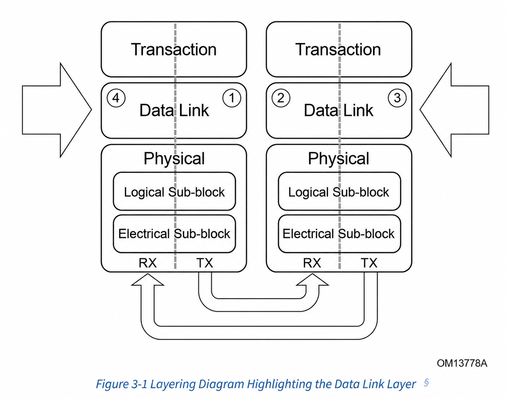
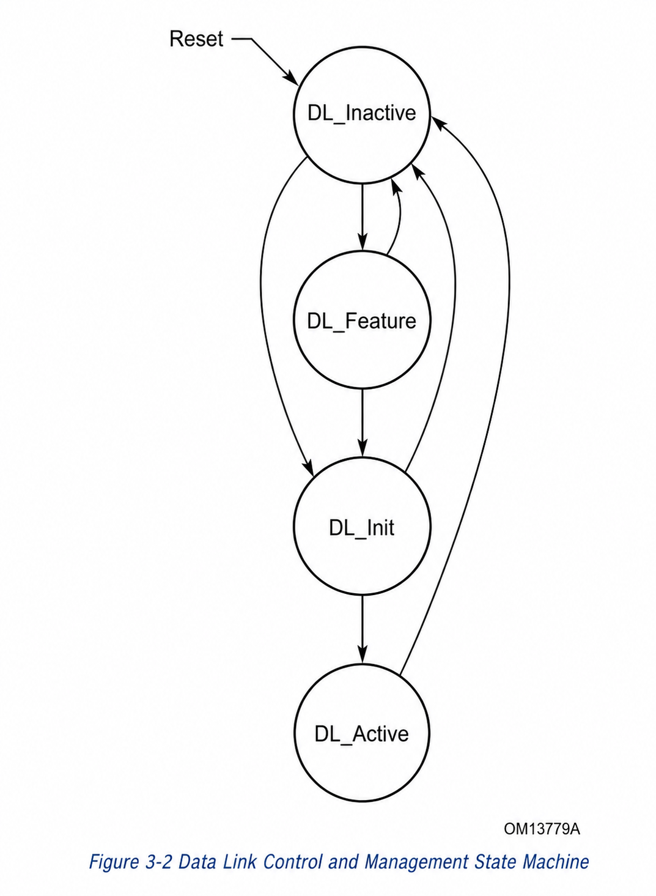

# DLL

DLL（Data Link Layer，数据链路层）位于事务层（Transaction Layer）和物理层（Physical Layer）之间，是 PCIe 分层架构中负责可靠链路传输的一层。它不关心事务请求的具体语义，也不直接处理电气信号，而是将事务层产生的 TLP（Transaction Layer Packet）可靠地交付给对端的数据链路层。

*图：PCIe 分层结构中数据链路层的位置。虚线可理解为每个端口内部的 RX/TX 边界；数据通过物理层在两个端口之间传输，而 DLL 在本端事务层与物理层之间完成可靠交付。图中的 ①至④表示两个方向上 TLP 在事务层与 DLL 之间的上下行路径。*

## DLL 的功能和职责

- **可靠交付**：在传统 Non-Flit 传输中，DLL 为 TLP 编号、保存尚未确认的发送副本，并利用接收序号检测缺失或重复的 TLP。它解决的是单条链路上的瞬态传输错误，不改变 TLP 的事务语义。
- **确认与重放**：接收端以 ACK/NAK DLLP（Data Link Layer Packet）确认接收结果。发送端仅在收到 ACK 后释放对应的重放缓冲区；收到 NAK 或重放计时器到期时，从要求的位置重新发送。
- **数据完整性保护**：传统 Non-Flit 模式下，DLL 为传输的 TLP 生成 LCRC（Link CRC），接收端先校验 LCRC，再决定确认、拒绝或交付。LCRC 保护的是一跳链路上的传输内容，不应与端到端保护用的 ECRC 混为一谈。
- **信用式流量控制**：接收端通过 DLLP 公告可用缓冲空间，发送端按已获信用发送 Posted、Non-Posted 和 Completion 三类 TLP 的 Header/Data 内容，防止接收端缓冲溢出。
- **链路与电源管理报文**：DLLP 除 ACK/NAK 和流控信息外，也承载与链路状态、电源管理及厂商特定功能相关的链路级消息。
- **层间边界**：向下交给物理层的是可在该链路发送的编码单元；向上只交付已通过链路级检查的 TLP。因此，事务层不需要为普通瞬态链路错误自行实现重传。

> DLL 的可靠性范围仅限于一跳 PCIe 链路。TLP 每经过一个 PCIe Switch 端口，都会在该链路上重新进行序列号、LCRC、ACK/NAK 与重放处理。

## DLL 状态机

DLL 并非在链路上电后立即允许事务流量通过。它遵循数据链路控制与管理状态机（Data Link Control and Management State Machine），依次完成可选功能协商与流控初始化；只有进入 `DL_Active` 后，链路才处于可正常传输 TLP/DLLP 的工作状态。

*图：数据链路控制与管理状态机。图中的回退路径表示链路不再满足数据链路工作条件时，DLL 需要退出当前初始化或活动阶段，并返回非活动状态重新建立。*

### DL_Inactive

`DL_Inactive` 是 Reset 后的初始或非活动状态。此时 DLL 不提供已建立的数据链路服务，不能进行正常的事务传输。链路需要先满足物理层和链路状态机的前提条件，才能进入后续的数据链路建立流程。

rules：

- 作为状态机中的初始化状态，一般伴随着pcie hot、warm及cold reset，但并不会收FLR的影响

| 类型 | 是否断电 | 常见触发方式 | 影响 |
| --- | --- | --- | --- |
| **Cold Reset**（冷复位） | 是 | 上电、断电后重新供电、热插拔重新上电 | 最彻底；设备、链路和配置状态从上电初始条件重新建立 |
| **Warm Reset**（温复位） | 否 | `PERST#` 等平台复位信号 | 不移除设备电源，但设备需重新初始化，PCIe 链路重新训练 |
| **Hot Reset**（热复位） | 否 | 已建立链路上的带 Hot Reset 标志 TS1 Ordered Set | 带内重置一条下游 PCIe 链路；不需要拉低 `PERST#` 或重新供电 |

question：为什么DLL不会因为FLR进入DL_Inactive？

主要原因是FLR本质上是为了复位function，一个设备可以有多个function。如果一个function的逻辑复位会导致DLL进入inactive状态，那么整个DLL负责的link都会被重置，重新进入训练对齐的初始化步骤。很明显，这会导致其余function也被迫进入重置状态，这是违背了function的设计初衷的。

### DL_Feature

`DL_Feature` 用于交换和处理 Data Link Feature DLLP，以完成适用的数据链路功能协商。并非所有链路都会在此状态长时间停留；若没有需要协商的功能，状态机会按规范条件快速推进至 `DL_Init`。在该阶段，普通 TLP 事务传输仍不可用。

### DL_Init

`DL_Init` 用于建立数据链路的运行条件，重点是双方流控信息的初始化。该状态的关键产出是：双方都拥有可信的接收缓冲信用视图。在此之前，即使物理链路已经建立，也不能按正常运行方式发送事务流量。

### DL_Active

`DL_Active` 表示数据链路已可用。此时可以正常传输 TLP 和 DLLP，TLP 的可靠交付、ACK/NAK、Replay Buffer 重放以及运行期流控更新均在该状态下工作。

图中从 `DL_Feature`、`DL_Init` 和 `DL_Active` 返回 `DL_Inactive` 的弧线尤其重要：它说明 DLL 的“可用”依赖于底层链路状态。链路训练重启、复位或其他使数据链路条件失效的事件发生时，原有的确认、重放和信用状态不能继续沿用，必须重新建立。

## 传统 Non-Flit 模式的数据路径

以下过程描述传统 TLP/DLLP 传输；它是理解 DLL 重放机制最直接的模型。

1. **事务层提交 TLP**：DLL 先检查该 TLP 类型所需的流控信用是否足够。信用不足时，TLP 必须继续留在发送侧。
2. **DLL 封装并保存副本**：对需要可靠交付的 TLP，发送端分配序列号、生成 LCRC，并将可重放的副本放入 Replay Buffer，然后交由物理层发送。
3. **接收端检查顺序和 LCRC**：接收端仅接受期望序列号的有效 TLP；发现 LCRC 错误、缺失或不符合期望的序列号时，不向事务层交付该 TLP。
4. **通过 DLLP 反馈结果**：成功接收时返回 ACK；需要发送端回退重传时返回 NAK。ACK 同时允许发送端回收已确认的 Replay Buffer 空间。
5. **有序交付事务层**：只有通过链路级检查且顺序正确的 TLP 才向上传递。重放在本链路内完成，对上层透明。

这里的“重放”不是软件重试：它由硬件链路逻辑在有限的重放缓冲区和计时器约束下完成。若错误无法在规定条件内恢复，链路会进入恢复或错误处理路径，而不是无限重传。

## 流量控制：为什么 DLL 需要信用

PCIe 是接收端驱动的信用式流控。每个接收端根据自身缓冲能力公布信用，发送端将信用视作发送许可。

- 信用按 **Posted（P）**、**Non-Posted（NP）** 和 **Completion（Cpl）** 三类请求/响应流量分别维护；每类又区分 Header 与 Data 信用。
- 链路初始化期间，双方通过初始化流控 DLLP 建立彼此的初始信用视图；运行期间则以流控更新 DLLP 报告新增的可用空间。
- 发送端必须同时满足所需的 Header 和 Data 信用，才可发送相应 TLP。已发送的信用在接收端释放缓冲后，随更新消息返还。

信用控制解决的是“接收端是否有地方存放 TLP”，而 ACK/NAK 解决的是“已发送的 TLP 是否可靠到达”。两者彼此独立，但都由 DLL 协同完成。

## DLLP、TLP 与 LCRC 的关系

| 项目 | 用途 | 与可靠性的关系 |
| --- | --- | --- |
| TLP | 携带 Memory、Configuration、Message、Completion 等事务语义 | 传统模式下由 DLL 编号、保护并在必要时重放 |
| DLLP | 传递 ACK/NAK、流控以及链路级控制信息 | 是确认、重放和信用更新的控制通道 |
| LCRC | 单链路 CRC 校验 | 用于发现链路传输损坏；校验失败的 TLP 不向事务层交付 |
| ECRC | 可选的端到端完整性检查 | 跨越多个链路，不能替代每一跳的 LCRC 和 DLL 重放 |

> ACK、NAK 和流控更新本身也是链路级协议的一部分。分析抓包时，不能只看 TLP；缺少 DLLP 往往无法解释“为什么未继续发送”或“为什么发生重放”。

## Flit Mode 下的差异

PCIe 6.0 及后续规范引入 Flit Mode。此时链路以固定大小的 FLIT 为传输和可靠性处理单位，DLL 的职责仍是可靠交付、流控和链路级控制，但封装、完整性校验以及重放的具体格式不再等同于传统 Non-Flit TLP 的“序列号 + LCRC”模型。

阅读或实现时应先确认链路工作模式：

- **Non-Flit Mode**：以传统 TLP/DLLP 规则理解序列号、LCRC、ACK/NAK 与 Replay Buffer。
- **Flit Mode**：以 FLIT、Data Link Protocol（DLP）和该模式定义的 CRC/FEC、确认及重放规则为准。

因此，不应将 Non-Flit 的字段布局、计时器或重放细节直接套用到 Flit Mode。两种模式共享 DLL 的目标，但报文组织和具体状态机要求不同。

## 与 LTSSM 和错误恢复的边界

DLL 只在数据链路可用时提供服务；链路训练、速率/宽度协商和电气状态转换由物理层及 LTSSM（Link Training and Status State Machine）主导。当 DLL 检测到无法由正常重放恢复的异常时，需要与链路状态机的恢复流程配合。

实践上可以这样划分：

- **可由 ACK/NAK 与 Replay Buffer 修复的瞬态错误**：由 DLL 在当前链路内处理。
- **训练、均衡、失锁、严重协议异常或重复恢复失败**：进入 LTSSM 相关的恢复、重新训练或错误报告路径。
- **跨设备、跨交换端口的事务结果**：由事务层、软件和平台错误处理机制关注，DLL 不提供端到端投递保证。
