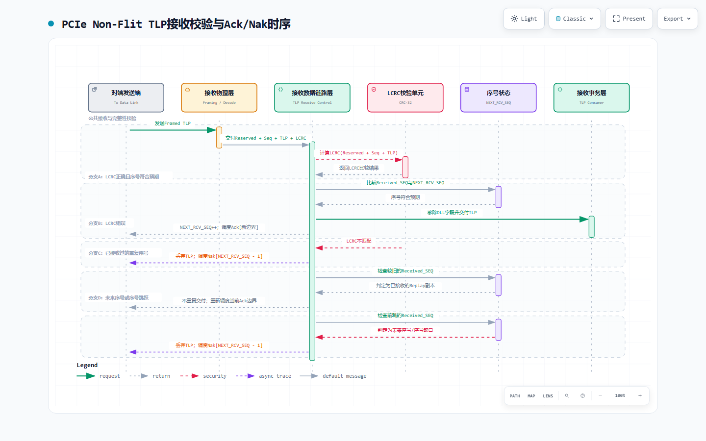
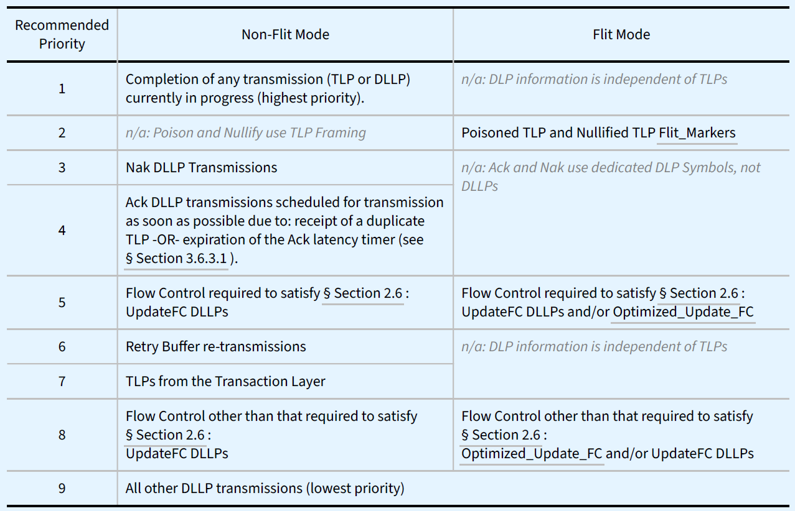

## 1 为什么PCIe需要重传机制

PCIe的数据链路重传称为**Replay**。它用于恢复单条Link上的瞬态传输错误，例如TLP或Flit损坏、Ack/Nak反馈丢失等。Replay完全由相邻两个Port的数据链路层完成，不要求事务层或软件重新提交事务。

PCIe 7.0 Base Specification于2025年6月发布，最高数据速率为128.0 GT/s。PCIe 7.0继续使用PCIe 6.0引入的PAM4与Flit Mode，同时保留与旧设备和Non-Flit Mode互操作的能力。本文以PCIe 7.0 Base Specification的§3.6为主线，重点解释以下问题：

1. 为什么发送完成后仍然需要保存TLP或Flit？
2. Ack、Nak和Replay Timer分别解决什么问题？
3. 收到Nak和发生Replay Timeout时，发送端如何确定重传起点？
4. Non-Flit Mode与Flit Mode的重传粒度有何不同？

> Replay是逐跳（Link-local）可靠性机制。TLP经过Switch后，会在下一条Link上重新建立独立的序号、确认和Replay状态。

## 2 重传机制的基本闭环

无论采用哪种传输模式，重传机制都可以抽象为以下闭环：

```text
发送数据并分配序号
        ↓
将副本保存到Transmit Retry Buffer
        ↓
通过物理链路发送
        ↓
接收端执行完整性与顺序检查
        ↓
   ┌────┴────┐
   │         │
接收成功    检测到错误
   │         │
Ack反馈     Nak反馈
   │         │
释放副本    启动Replay
   │         │
   └────┬────┘
        │
若Ack/Nak长时间均未返回
        ↓
REPLAY_TIMER超时并启动Replay
```

这里存在三个相互配合的核心机制：

- **Transmit Retry Buffer**：保存尚未得到确认的数据副本，保证发送端具有可重放的数据。
- **Ack/Nak**：接收端向发送端反馈已正确接收的边界，或者要求发送端执行Replay。
- **REPLAY_TIMER**：处理Ack/Nak本身丢失的情况，避免发送端永久等待。

### 2.1 Replay在链路初始化时做什么

Replay在初始化阶段的目标不是执行一次重传，而是建立一套**没有历史包袱的可靠传输上下文**。只有数据链路进入`DL_Active`并真正发送了需要可靠交付的数据后，Replay机制才开始动态工作。

以Non-Flit Mode为例，DLCMSM进入`DL_Inactive`时，Replay相关状态应回到初始基线：

| 状态 | 初始化结果 | 原因 |
| --- | --- | --- |
| Transmit Retry Buffer | 逻辑上为空 | 此时不存在属于新数据链路会话的未确认TLP |
| 发送序号 | 下一个新TLP从`000h`开始编号 | 为两端建立相同的序号起点 |
| 累计确认边界 | 位于`FFFh`，即`000h`的模4096前一项 | 表示尚未确认任何新TLP |
| 接收端期望序号 | `000h` | 第一个可接受的新TLP应使用序号0 |
| `REPLAY_TIMER` | 清零并停止 | Buffer为空，没有需要等待Ack的对象 |
| `REPLAY_NUM` | 清零 | 尚未发生连续Replay失败 |
| Replay进行中、Nak调度等标志 | 清除 | 不允许上一条数据链路会话的控制状态泄漏进来 |

这里将确认边界初始化为`FFFh`并不表示真的收到了序号4095，而是利用12位序号回卷关系表示“下一项是0”：

```text
初始状态：ACKD_SEQ = FFFh，NEXT_TRANSMIT_SEQ = 000h

发送第一个TLP：Seq = 000h
收到Ack[000h]：确认边界从FFFh推进到000h
```

随后数据链路经历`DL_Feature`（若适用）和`DL_Init`。这一阶段主要完成Data Link Feature Exchange和VC0流量控制初始化，并不是Replay初始化握手：

1. 双方不会通过Ack/Nak交换“Replay Buffer为空”这一事实；空Buffer和初始序号是本地状态机按规范建立的共同基线。
2. `InitFC1/InitFC2` DLLP建立的是Flow Control Credit视图，不负责确认TLP，也不会启动`REPLAY_TIMER`。
3. 数据链路尚未可用时，即使接收到TLP，也不能用Ack把它确认为新会话中已可靠接收的数据，否则发送端可能错误地释放Retry Buffer。
4. 只有初始化完成、两端进入`DL_Active`后，事务层流量才按正常路径写入Retry Buffer、分配序号并发送。

因此，第一个TLP把Replay机制从“已初始化但空闲”带入“正在保护数据”的状态：

```text
DL_Inactive
  └─ 清空Replay上下文，序号建立为FFFh/000h边界
        ↓
DL_Feature / DL_Init
  └─ 完成功能与流控初始化；Replay Timer保持停止
        ↓
DL_Active
  └─ 第一个TLP写入Retry Buffer并以Seq 000h发送
        ↓
该TLP最后一个Symbol发出
  └─ 若Replay Timer尚未运行，则开始计时
```

硬件实现时可以把这部分拆成两个动作：`replay_context_reset`负责清空Buffer有效位、序号、计数器和控制标志；`replay_enable`则由数据链路可用状态门控。这样能够避免在流控初始化尚未完成时误启动Timer或误接受Ack/Nak。

需要特别区分**全新初始化**和**Recovery重新训练**：

- 如果物理层始终保持`Physical LinkUp = 1b`，LTSSM短暂进入Recovery并不代表DLCMSM进入`DL_Inactive`。此时未确认TLP和Replay上下文需要保留，训练完成后继续恢复传输。
- 如果`Physical LinkUp`变为`0b`并使DLCMSM进入`DL_Inactive`，旧数据链路会话才真正结束；Replay Buffer、序号和Timer状态重新初始化，不能再重放旧会话中的TLP。

这个边界非常重要：**Recovery可以保留Replay上下文，DL_Inactive则重建Replay上下文。**

## 3 Non-Flit Mode的发送端状态

### 3.1 Sequence Number

Non-Flit Mode为需要可靠传输的TLP分配Data Link Layer Sequence Number。序号使接收端能够判断：

- 当前TLP是否正好是下一个期望的TLP；
- 中间是否缺失了TLP；
- 当前TLP是否是Replay产生的重复副本。

Sequence Number描述的是本条Link上的发送顺序，不是事务层的Tag，也不是全局事务编号。当TLP经过Switch转发到下一条Link时，会使用下一条Link的数据链路序号。

Sequence Number位宽12bit，会由DLL处理时加在TLP前，并根据Sequency_number + TLP计算得出LCRC（CRC32，0x04C1DB7，初始值0xFFFFFFFF）

最终形成结构：
| 16 bit |      12 bit     | variable | 32 bit | 16 bit |
|  STP   | Sequence Number |   TLP    |  LCRC  |  END   |

序列号的上限是4096，窗口宽度则是2048。

> **question：为什么窗口宽度被设计为序列号上限的1/2？**
>
> 最核心的目的就是为了确定序列号的前后关系，主要考虑的是序列号到上限回滚的情况。比如序列4050和13，谁先谁后可以根据``|abs(4050-13)>2048``来确定，这表示seq4050是在seq13之前到来的。
>
> 使用半值作为判断的边，领先还是落后所占的数值比例一致，不会出现做差结果同时落在两区域的情况
>
> ex：采用4096/3000，对于序列号3100和100，会出现：
> （3100-100）mod 4096 = 3000
> （100-3100）mod 4096 = 1096
> 均落在3000的窗口内，也即领先和落后的区域发生重叠，无法区分序列号的先后关系
>
> **question：为什么上限是4096？**
>
> 因为够用了，协议规定，历史缘由

接收端返回的ACK/NAK的序列号均规定为：``NEXT_RCV_SEQ - 1``

## 4 Transmit Retry Buffer：保存可重放副本

### 4.1 Replay Buffer保存什么

发送端将TLP交给物理层时，不能立即删除本地副本，而是必须在Transmit Retry Buffer中保存该TLP，直到有效Ack或Nak推进累计确认边界并确认该TLP。

Non-Flit Mode下，每个有效条目至少需要包含或能够重建：

| 信息 | 用途 |
| --- | --- |
| 原始Transaction Layer TLP | 在Replay时恢复相同的Header、Data和可选ECRC |
| Data Link Sequence Number | 保证重放副本继续使用第一次发送时的序号 |
| LCRC或重新计算LCRC所需的信息 | 重新形成受Data Link Layer保护的TLP |
| 条目有效位及顺序信息 | 区分空条目，并保持原始发送顺序 |

协议描述的是行为要求，不强制Replay Buffer必须使用某一种SRAM宽度或必须逐位保存完整线路编码。实现可以保存已经完成Data Link封装的副本，也可以保存TLP、序号及相关元数据，并在Replay时重新生成LCRC；但重新发送的TLP内容和Sequence Number必须与原发送保持一致。

Nullified TLP不属于需要可靠重放的有效TLP，不占用正常的Replay序号，也不应作为有效条目继续保留在Retry Buffer中。

### 4.2 写入与释放时机

TLP必须在发送端仍然能够完整恢复它时写入Replay Buffer，不能等到整个TLP已经离开物理接口后才尝试保存。逻辑数据路径可以表示为：

```text
Transaction Layer
        │
        ▼
分配Sequence Number并生成LCRC
        │
        ├──────────────► Physical Layer
        │
        └──► Transmit Retry Buffer
                     │
                     └── Ack/Nak推进确认边界后释放
```

Ack和Nak采用累计确认语义。收到新的`AckNak_Seq_Num`后，发送端从最老条目开始，释放直到该确认边界为止的所有TLP，而不是只释放与DLLP序号相等的一个条目：

```text
Retry Buffer：Seq 20 | Seq 21 | Seq 22 | Seq 23
收到Ack/Nak 21

释放：Seq 20、Seq 21
保留：Seq 22、Seq 23
```

仅仅完成第一次发送或完成一次Replay都不能释放条目。只要累计确认边界尚未覆盖该TLP，它就必须继续留在Buffer中。

### 4.3 Buffer指针与Replay范围

规范不要求特定微架构，但环形FIFO是一种直观实现。可以维护以下逻辑边界：

| 指针/边界 | 含义 |
| --- | --- |
| `oldest_unacked_ptr` | 指向最早仍未确认的TLP，也是通常的Replay起点 |
| `write_ptr` | 指向下一个可写入的新条目 |
| `replay_ptr` | 指向当前准备重放的条目 |
| `replay_end_ptr` | 记录本轮Replay启动时最新的已发送条目 |

```text
              oldest_unacked_ptr
                       ↓
已释放空间 | Seq 22 | Seq 23 | Seq 24 | 空闲空间
                       ↑                 ↑
                  replay_ptr         write_ptr
```

由Nak触发时，先按照Nak的累计确认边界释放旧条目，再从新的`oldest_unacked_ptr`开始Replay；由Timer触发时没有新的确认边界，因此从当前最老未确认条目开始。Replay期间阻止新TLP进入后，`replay_end_ptr`给出了稳定的本轮重放终点。

Replay期间到达的新Ack/Nak仍必须处理。若它确认了尚未开始重发的条目，实现可以跳过这些条目；但一旦某个TLP已经开始重发，就必须完整发送结束。

### 4.4 与Flow Control和发送背压的关系

每个进入Replay Buffer的TLP在第一次发送前已经通过Flow Control Credit检查，接收端已经为它分配过相应空间。因此Replay不会第二次消耗Credit，也不需要重新执行Flow Control同步。

但新的Transaction Layer TLP仍同时受到两类资源限制：

- 必须拥有足够的Header/Data Credit；
- Replay Buffer必须存在可写空间，并满足序号窗口限制。

如果Replay Buffer已满，即使对端还有Credit，发送端也必须对Transaction Layer施加背压；否则新TLP发送后将没有可供错误恢复的本地副本。

### 4.5 初始化、Recovery与Replay结束

- **进入`DL_Inactive`**：旧数据链路会话结束，Replay Buffer逻辑清空，所有条目失效。
- **LTSSM进入Recovery但`Physical LinkUp`保持`1b`**：数据链路会话没有被销毁，未确认条目必须保留，训练完成后继续恢复传输。
- **完成本轮Replay发送**：可以退出Replay控制状态并重新接收新TLP，但被重放条目仍保留，直到后续Ack/Nak真正确认。
- **累计确认覆盖全部条目**：Replay Buffer变空，`REPLAY_TIMER`停止。

因此，Replay Buffer为空表示“所有已发送TLP都已经得到累计确认”，而不是简单表示“所有待重放TLP都已经重新发送了一遍”。

## 5 REPLAY_TIMER：限制无确认进展时间

发送端还需要维护Replay相关状态：

- `REPLAY_TIMER`：监视发送端是否长时间没有获得有效的确认进展。
- `REPLAY_NUM`：记录连续Replay行为，用于识别链路是否反复重放仍无法恢复。

replay_timer满足如下条件：

- 当replay buffer中有tlp而在规定时间周期内未收到ack/nak，超过replay_timer上限值时，会触发replay机制
- replay_timer取值限制遵循规则：

>| Extended Synch | Simplified REPLAY_TIMER Limit | 范围要求 |
>| --- | ---: | --- |
>| Clear | 24,000～31,000 Symbol Times | 包含上下限，`-0%/+0%` |
>| Set | 80,000～100,000 Symbol Times | 包含上下限，`-0%/+0%` |
>
>如果仍有未确认TLP时`Extended Synch`发生变化，实现可以选择在以下任一时刻采用新的`REPLAY_TIMER` Limit：
>
>- `Extended Synch`状态发生变化时立即调整；
>- 等到下一次`REPLAY_TIMER`复位时再调整。

Extended Synch主要用于测试过程中的链路调试。因为链路调试一般通过探头或其他非端点式接入，这些方式会导致不符合预期的衰减和更复杂的时钟回复，同时由于探头不属于端点，无法参与链路训练过程。因此ES通过增加FTS（Fast Training Sequence）来为分析仪锁定信号提供足够的时间。

在这个情况下，会导致ACK/NAK回复时间较正常更慢（额外FTS占用了ACK/NAK回复时间），进而导致DLL的replay timer超时，进入replay状态。

### 5.1 不同速率能力与传输模式的适用规则

`REPLAY_TIMER`规则的选择不仅取决于当前Link速率，还取决于实现支持的最高数据速率以及当前采用Non-Flit还是Flit Mode：

| 实现能力与工作模式 | 必须或允许采用的规则 |
| --- | --- |
| 实现支持16.0 GT/s或更高数据速率，当前工作在Non-Flit Mode | 在所有实际运行速率下都必须使用Simplified `REPLAY_TIMER` Limits |
| 实现只支持低于16.0 GT/s的数据速率，当前工作在Non-Flit Mode | 强烈建议在所有运行速率下使用Simplified Limits，但允许使用PCIe 3.1定义的传统`REPLAY_TIMER` Limits |
| 工作在Flit Mode | 在所有数据速率下都必须使用§4.2.3.4.2.1.6中Replay Schedule Rule 0定义的Replay Timeout规则 |

这里判断的是实现的最高能力，而不是当前协商出来的Link速率。例如，一个最高支持16.0 GT/s的Port即使当前降速到8.0 GT/s并工作在Non-Flit Mode，仍必须使用Simplified `REPLAY_TIMER` Limits。

Flit Mode不使用上述Non-Flit Simplified Limit表来直接确定Replay Timeout，而是统一按照Replay Schedule Rule 0处理。也就是说，不能因为Flit Mode当前运行在较低NRZ速率，就退回Non-Flit Mode的Timer规则。

```text
当前是否工作在Flit Mode？
├─ 是
│  └─ 所有速率统一使用Replay Schedule Rule 0
│
└─ 否，工作在Non-Flit Mode
   └─ 实现最高支持速率是否≥16.0 GT/s？
      ├─ 是：所有速率强制使用Simplified REPLAY_TIMER Limits
      └─ 否：推荐使用Simplified Limits，
             但允许使用PCIe 3.1传统Limits
```

### 5.2 Timer监视的对象

`REPLAY_TIMER`不是每个TLP各自拥有的驻留时间计数器，而是整个发送数据链路共享的“确认是否取得进展”计时器。只要Retry Buffer中存在未确认TLP，它就限制发送端能够容忍的最长无确认进展时间。

这里的“进展”是累计确认边界`ACKD_SEQ`向前移动，而不是简单收到任意Ack/Nak。重复Ack没有确认新的TLP，不能用来无限延长等待时间。

### 5.3 Timer从哪里开始计时

`REPLAY_TIMER`不是在TLP写入Transmit Retry Buffer时启动，而是在任意TLP发送或重传的最后一个Symbol发出时启动，前提是Timer尚未运行。Timer一旦开始运行，随后继续发送普通新TLP不会反复将其清零，否则持续发送新TLP可能无限延长最早未确认TLP的等待时间。

```text
TLP写入Transmit Retry Buffer
        │
        │ Timer尚未启动
        ▼
通过物理链路发送TLP
        │
        ▼
发出该TLP的最后一个Symbol
        │
        └─ REPLAY_TIMER尚未运行时，从此处开始计时
```

### 5.4 Timer状态更新规则

运行过程中，`REPLAY_TIMER`按照以下规则更新：

- **收到带来确认进展的Ack**：如果该Ack确认了Retry Buffer中的一个或多个新TLP，并且仍有其他未确认TLP，Timer清零并重新启动。
- **收到没有确认进展的重复Ack**：Timer不重新启动。该规则防止重复Ack掩盖链路长期没有取得进展的问题。
- **收到Nak**：除正在Replay的情况外，Timer清零并保持停止，等待Replay过程提供新的启动点。
- **开始一次Replay**：发送第一个重传TLP的最后一个Symbol时，Timer清零并重新启动。
- **全部TLP均已确认**：Timer清零并保持停止，直到之后再次满足启动条件。
- **链路正在重新训练**：LTSSM处于Recovery或Configuration时，Timer保持当前值，不继续计数。
- **Timer到期**：Timer清零并保持停止，同时触发Replay；随后在第一个重传TLP的最后一个Symbol发出时重新启动。

### 5.5 一个连续发送示例

例如发送端连续发送Seq 10、11和12时，Timer在Seq 10的最后一个Symbol发出后启动，发送Seq 11和12不会刷新它。如果随后收到确认至Seq 10的Ack，由于确认边界取得进展但仍有Seq 11和12未确认，Timer重新启动；再次收到确认至Seq 10的重复Ack则不会重新启动。收到确认至Seq 12的Ack后，Retry Buffer不再包含未确认TLP，Timer停止。

因此，`REPLAY_TIMER`不是为每个TLP分别配置的计时器，也不是简单测量某一个TLP在Buffer中停留的时间。它用于限制发送端在存在未确认数据时，能够容忍的最长“无确认进展”时间。

### 5.6 Timer到期后的动作

单次Replay Timer Timeout并不等价于Link立即进入`DL_Inactive`。PCI-SIG的FAQ明确说明：Timer到期后应重传Transmit Retry Buffer中的TLP，同时报告Replay Timer Timeout错误。

> **question：为什么Replay机制需要Replay Timer**
>
> Replay在正常情况下由Nak触发，但如果TLP、Ack或Nak因为链路原因无法传达，则需要通过超时机制来避免协议长期停滞。
> 可能出现以下情况：
>
> 1. TLP在从Transmitter到Receiver的过程中遗失。如果Receiver没有收到后续TLP，就可能无法通过序号缺口发现该TLP丢失，因此不会发送Nak；Transmitter只能依靠Replay Timer超时发现确认长期没有进展。
> 2. Ack在从Receiver到Transmitter的过程中遗失。Transmitter无法得知TLP已经被正确接收，会一直在Transmit Retry Buffer中保留其副本；Replay Timer超时后会重新发送未确认TLP。
> 3. Nak在从Receiver到Transmitter的过程中遗失。Transmitter不知道Receiver已经检测到错误，而Receiver仍在等待缺失或损坏TLP的重传；Replay Timer超时后，Transmitter会主动启动Replay。
>
> 因此，Replay Timer为Ack/Nak反馈机制提供了一条超时恢复路径。它不能保证某次Replay一定成功，但可以保证发送端不会因为反馈丢失而无限等待。如果多次Replay仍然无法取得确认进展，则通过`REPLAY_NUM` Rollover触发进一步的错误报告和链路重新训练。
>
> 更进一步，**协议如何避免链路一直进行重传？**
>
> 协议通过`REPLAY_NUM`检测连续Replay仍无法取得确认进展的情况。它限制的不是链路运行期间的Replay总次数，而是连续没有新的TLP得到确认时所执行的Replay次数；一旦收到能够推进确认边界的Ack或Nak，`REPLAY_NUM`就会复位。
>
> 在Non-Flit Mode中，`REPLAY_NUM`是一个2位计数器。每次启动Replay时递增：
>
> ```text
> 00b → 01b → 10b → 11b → 00b（Rollover）
> ```
>
> 当`REPLAY_NUM`从`11b`回卷到`00b`时，说明多次Replay仍未取得确认进展。此时发送端：
>
> 1. 报告`REPLAY_NUM Rollover`错误。
> 2. 通知物理层重新训练Link。
> 3. 等待LTSSM完成Recovery。
> 4. 训练成功后，继续Replay尚未确认的TLP。
>
> 链路重新训练本身不会清空Transmit Retry Buffer。如果重新训练过程中`Physical LinkUp`持续为`1b`，DLL状态和未确认TLP仍被保留；只有物理层报告`Physical LinkUp = 0b`、使DLCMSM进入`DL_Inactive`时，原有Replay状态和Retry Buffer才会被重置。
>
> 因此，`REPLAY_NUM`并不是达到上限后直接丢弃事务，而是将错误恢复从数据链路重放升级为物理链路重新训练：
>
> ```text
> Nak或Replay Timer超时
>          ↓
>       启动Replay
>          ↓
> 连续Replay仍无确认进展
>          ↓
> REPLAY_NUM Rollover
>          ↓
> LTSSM进入Recovery并重新训练Link
> ```


## 6 接收端如何产生Ack和Nak

接收端收到Non-Flit TLP后，需要检查至少两类信息：

1. **完整性**：LCRC是否正确。
2. **顺序**：Sequence Number是否符合当前期望值。

处理结果可以简化为：

| 接收结果 | 接收端动作 | 发送端后续动作 |
| --- | --- | --- |
| LCRC正确且序号符合预期 | 接收TLP并更新确认边界 | 收到Ack后释放已确认副本 |
| LCRC错误或检测到序号缺口 | 不向事务层交付错误TLP | 收到Nak后从未确认边界开始Replay |
| 收到已经正确接收过的Replay副本 | 不重复交付事务层 | 重新反馈当前确认边界 |

### 6.1 Non-Flit TLP接收校验时序

Physical Layer完成解码和Framing检查后，将Framed TLP以及相关错误指示交给Receive Data Link Layer。随后按照以下顺序处理：

1. **计算并比较LCRC。** 接收端以`Reserved + Sequence Number + Transaction Layer TLP`为输入，按照PCIe规定的初值、位序和取反规则计算32-bit LCRC，再与包尾携带的LCRC比较。接收的LCRC字段自身不参与计算。
2. **检查Sequence Number。** 只有LCRC正确时，才进一步判断`Received_SEQ`与`NEXT_RCV_SEQ`的关系。
3. **正常交付。** 如果`Received_SEQ == NEXT_RCV_SEQ`，移除Data Link Layer添加的Reserved、Sequence Number和LCRC，将原始TLP交付Transaction Layer，然后递增`NEXT_RCV_SEQ`并调度累计Ack。
4. **处理重复Replay副本。** 如果序号属于已经正确接收过的旧窗口，则丢弃副本，不再次交付Transaction Layer，并重新调度当前累计Ack边界。
5. **请求重放。** 如果LCRC错误，或者序号属于尚未接收的未来位置、形成序号缺口，则丢弃TLP，并在尚未调度Nak时发送`Nak[NEXT_RCV_SEQ - 1]`。

Ack和Nak在这里都是“调度发送”，不一定在校验完成后的下一个Symbol立即上线；接收端仍需遵守Ack/Nak发送延迟和DLLP调度规则。下图中的分支A～D是同一次接收检查的互斥结果，而不是依次执行的四个阶段。



*图：Non-Flit TLP从物理层交付到LCRC检查、序号分类以及Ack/Nak调度的完整路径。可打开[交互式时序图](/assets/diagrams/pcie-non-flit-tlp-receive-sequence.html)切换深浅主题、缩放并导出SVG或PNG。*

Ack只表示数据已经可靠通过当前Link，它不代表事务已经在最终Completer执行完成。例如Memory Read Request的Ack与随后返回的Completion是两个不同层次的事件。

## 7 触发Replay的两条主要路径

### 7.1 收到Nak

Nak表示接收端已经发现错误或序号不连续。发送端根据Nak携带的确认边界，找到Transmit Retry Buffer中最早仍未确认的TLP，并从该位置开始Replay。

这种方式反应最快，因为发送端不需要等待Timer到期：

```text
Tx发送：Seq 100、101、102、103
Rx确认：正确收到至Seq 101
Rx发现：Seq 102损坏
Rx发送：Nak，确认边界停留在101
Tx动作：从Seq 102开始Replay
```

### 7.2 REPLAY_TIMER超时

如果Transmit Retry Buffer中仍然存在未确认TLP，并且在超过适用的`REPLAY_TIMER Limit`后仍未收到任何Ack或Nak，发送端必须启动Replay。

这个规则解决的是“反馈丢失”问题：原始TLP可能已经到达，但Ack在返回过程中损坏；也可能原始TLP和Nak均未成功到达发送端。发送端无法区分这些情况，因此只能保留副本并在超时后重新发送。

## 8 PCIe 7.0规定的Simplified REPLAY_TIMER Limit

PCIe 7.0在Non-Flit Mode下给出了Simplified REPLAY_TIMER Limit：

| Extended Synch | REPLAY_TIMER Limit |
| --- | ---: |
| Clear | 24,000～31,000 Symbol Times |
| Set | 80,000～100,000 Symbol Times |

上下限均包含在允许范围内，`-0%/+0%`表示实现选择的Limit不能在该范围之外增加额外容差。

### 8.1 Extended Synch为什么会改变Limit

`Extended Synch`主要用于测试场景。设置该位会延长部分物理层同步过程，因此允许更长的Ack/Nak返回等待时间，Replay Timer范围也随之增大。

如果存在未确认TLP时Extended Synch发生变化，实现可以选择：

- 在该位变化时立即调整`REPLAY_TIMER Limit`；或者
- 等待下一次`REPLAY_TIMER`复位时再使用新的Limit。

### 8.2 不同速率实现的要求

- **支持16.0 GT/s或更高速率的实现**：在Non-Flit Mode下，所有实际运行速率都必须使用Simplified REPLAY_TIMER Limit。
- **最高仅支持低于16.0 GT/s速率的实现**：强烈建议在所有速率使用Simplified Limit，但允许继续使用PCIe 3.1定义的传统Limit。

这里判断的是实现的最高能力，而不是当前协商速率。例如一个支持16.0 GT/s的Port当前降速到8.0 GT/s运行，仍属于必须使用Simplified Limit的实现。

> Symbol Time是规范定义的链路时间单位。分析Timer时应按照当前模式和编码规则换算，不能直接把Symbol Times当作固定数量的软件时钟周期。

## 9 Non-Flit Mode的重传实现规则

收到有效Nak或`REPLAY_TIMER`到期后，发送端不是立即从Buffer中任意取一个TLP发送，而是按照一组确定的规则完成Replay。实现时可以将它组织为独立的Replay控制状态机。

### 9.1 启动Replay

1. **处理触发事件。** 如果由Nak触发，先使用`AckNak_Seq_Num`推进累计确认边界，释放该边界及以前已经确认的Retry Buffer条目。真正的Replay起点是确认边界的下一序号，而不是Nak携带的序号本身。
2. **更新`REPLAY_NUM`。** 每次启动Replay时递增计数器；若发生Rollover，则报告错误并请求物理层重新训练Link。只要`Physical LinkUp`没有变为`0b`，Retry Buffer和数据链路状态仍需保留，训练完成后继续Replay。
3. **停止接收新的发送请求。** 暂时阻止Transmit Transaction Layer继续提交新TLP，避免新流量插入待重放序列：``Block acceptance of new TLPs from the Transmit Transaction Layer``
4. **完成当前正在发送的TLP。** 若触发Replay时一个正常TLP已经开始在线路上传输，必须先把该TLP完整发送完，不能从中间截断：``Once the Transmitter has started to resend a TLP, it must complete transmission of that TLP in all cases.``
5. **待replay事务。**replay开始时，replay buffer尚未被Ack/Nak累计确认的所有TLP就是待replay事务，需要完成这些事务的发送才能退出replay：``Once all unacknowledged TLPs have been re-transmitted, return to normal operation.``
6. **replay结束，**当所有待replay事务发送完成后，恢复为正常发送模式，继续传输tl的事务

### 9.2 按原始顺序重放

发送端从Retry Buffer中最早的未确认TLP开始，按照原始发送顺序重放所有未确认TLP：

```text
Retry Buffer：Seq 20 | Seq 21 | Seq 22 | Seq 23
Nak携带边界：Seq 21

释放：Seq 20、Seq 21
Replay顺序：Seq 22 → Seq 23
```

重放使用原来的Data Link Sequence Number和TLP内容，不能为重放副本分配新的序号。由于这些TLP第一次发送前已经通过Flow Control Credit检查，并且接收端已经为它们预留了空间，Replay时不重新消耗Credit，也不需要重新执行流控同步。

第一个重放TLP的最后一个Symbol发出时，发送端复位并重新启动`REPLAY_TIMER`。一旦某个重放TLP已经开始发送，即使此时收到Ack确认了该TLP，也必须将它完整发送结束。

### 9.3 Replay期间仍要处理Ack和Nak

Replay只阻止新的事务层TLP进入发送路径，不会关闭反向DLLP接收路径。此前发送的数据及其反馈仍可能在链路中飞行，接收端也会对重放成功的数据继续产生Ack。因此，Replay期间收到的Ack和Nak必须正常校验和处理：

- 有效Ack/Nak能够推进`ACKD_SEQ`时，释放累计确认边界以内的Retry Buffer条目。
- 实现可以把当前Replay完整执行完，也可以跳过尚未开始发送、但已被新反馈确认的TLP。
- 已经开始重发的TLP不能被截断，必须完整发送。
- 过期、重复或序号不属于当前未确认窗口的反馈，按照正常Ack/Nak检查规则处理，不能使确认边界倒退。

Ack/Nak采用累计确认，因此多个反馈可以进行状态折叠（Collapse）：

```text
Ack 20 → Ack 21 → Ack 23
```

只保留`Ack 23`即可，因为它已经包含此前两个Ack表达的全部确认进展。类似地：

```text
Nak 21 → 随后收到Ack 23
```

后到的`Ack 23`说明接收端已经正确接收至Seq 23，因此它覆盖了先前`Nak 21`所表达的重放要求。这里的“最新”必须依据当前未确认窗口和12-bit序号回卷关系判断，不能简单比较二进制数值大小。

### 9.4 结束Replay

当本轮需要重放的未确认TLP均已发送，发送端退出Replay状态并重新允许事务层提交新TLP。之后：

- 若Retry Buffer已经为空，`REPLAY_TIMER`停止；
- 若仍有TLP等待确认，Timer继续监视确认是否取得进展；
- 若再次收到有效Nak或Timer再次到期，则启动下一轮Replay。

可将完整控制过程概括为：

```text
Nak或REPLAY_TIMER到期
        ↓
更新确认边界和REPLAY_NUM
        ↓
阻止新TLP，完成当前在途TLP
        ↓
从最早未确认TLP开始按序重放
        ↓
持续处理并折叠Ack/Nak
        ↓
重放范围完成，恢复接收新TLP
```

## 10 一次完整的Non-Flit Replay示例

假设发送端依次发送四个TLP：

```text
Transmit Retry Buffer：

Seq 200 | Seq 201 | Seq 202 | Seq 203
```

处理过程如下：

1. 发送端为四个TLP分配序号并保存副本。
2. 接收端正确收到Seq 200和Seq 201。
3. Seq 202发生LCRC错误，接收端不将其交付事务层。
4. 接收端发送Nak，确认边界停留在Seq 201。
5. 发送端释放Seq 200和Seq 201的副本。
6. 发送端从Seq 202开始重放Seq 202和Seq 203。
7. 接收端正确接收重放数据并返回Ack。
8. 发送端释放剩余Retry Buffer空间，Replay结束。

如果第4步的Nak丢失，`REPLAY_TIMER`最终会代替Nak触发相同的重放动作。

## 11 Flit Mode下重传粒度发生了什么变化

PCIe 7.0的Flit组织方式与PCIe 6.0相同。每个Flit固定为256 Byte，其中包含：

| 区域 | 大小 | 用途 |
| --- | ---: | --- |
| TLP区域 | 236 Byte | 承载一个或多个TLP，TLP也可以跨Flit |
| DLP区域 | 6 Byte | 承载Ack/Nak、Replay等数据链路控制信息 |
| CRC | 8 Byte | 对TLP区域和DLP区域进行强错误检测 |
| FEC | 6 Byte | 对整个Flit提供低延迟纠错 |

接收端首先执行FEC纠错，再执行CRC检查。无法由FEC纠正且被CRC检测出的错误，会进入Flit级Replay流程。

这带来了几个重要差异：

- Replay Buffer保存的是需要重放的Payload Flit，而不再是带独立LCRC的Non-Flit TLP。
- 一个Flit可以包含多个TLP，一个TLP也可能跨越多个Flit，因此重放粒度不再等于事务层TLP边界。
- Ack/Nak等信息位于每个Flit固定的DLP区域，不需要等待独立DLLP插入链路。
- NOP Flit不消耗Payload Flit序号，不进入Tx Replay Buffer，也不需要Replay。

PCIe 7.0官方资料还区分了两种Nak策略：

- **Selective Nak**：在接收端能够确定具体受损Payload Flit时，尽量缩小需要重放的范围。
- **Standard Nak**：当接收状态不足以安全地选择局部范围时，回到更保守的确认边界执行重放。

Replay开始时，发送端通过Replay Command和显式发送序号重新建立接收端对重放序列的理解。这里的目标不是消除所有Replay，而是在保证可靠性的前提下减少不必要的重复数据和带宽损失。

## 12 Non-Flit与Flit Mode重传对比

| 对比项 | Non-Flit Mode | Flit Mode |
| --- | --- | --- |
| 基本保护和Replay单元 | 一个带Data Link Sequence Number和LCRC的TLP | 一个256 Byte Payload Flit |
| TLP与Replay单元关系 | 一个Replay单元正好对应一个TLP | 一个Flit可含多个TLP，一个TLP也可跨多个Flit |
| 错误处理流水线 | 检查TLP的LCRC，只检测不纠错 | 先以3路交织轻量FEC纠错，再检查Flit级64-bit CRC |
| 确认信息位置 | 独立的Ack/Nak DLLP，需要由链路调度发送 | 每个Flit固定DLP槽位都能携带Ack/Nak信息 |
| 累计确认对象 | 最新连续正确接收的TLP序号 | 最新连续正确接收的Payload Flit序号 |
| Tx Replay Buffer内容 | 尚未确认的完整TLP副本 | 尚未确认的Payload Flit及恢复重放所需的控制信息 |
| Replay起点 | 从Nak指出的确认边界之后，或最早未确认TLP开始 | 由Standard Nak或Selective Nak决定Payload Flit重放范围 |
| 重放时的边界信息 | TLP自身携带Data Link Sequence Number | Replay Command配合Explicit Sequence Number重建Flit序列 |
| 空闲传输单元 | 没有与NOP Flit完全对应的Replay单元 | NOP Flit不消耗Payload Flit序号、不进入Tx Replay Buffer、通常不重放 |
| Ack丢失处理 | `REPLAY_TIMER`超时后重放未确认TLP | 同样需要超时恢复，但重放对象是未确认Payload Flit |
| 对事务层的可见性 | Replay由本Link的DLL完成，对事务层透明 | 同样对事务层透明，即使一个TLP因跨Flit而随多个Flit重放 |

可以把两种模式的核心路径分别简化为：

```text
Non-Flit Mode
TLP → 添加Sequence Number和LCRC → 保存TLP副本 → 发送
    → Ack：释放累计确认的TLP
    → Nak/Timeout：从未确认TLP边界开始重放

Flit Mode
TLP流 → 装填为236 Byte TLP区域 → 组成256 Byte Flit → FEC/CRC保护
      → 保存Payload Flit → 发送
      → DLP Ack：释放累计确认的Payload Flit
      → DLP Nak/Timeout：以Flit为单位执行选择性或标准重放
```

### 12.1 为什么Flit Mode不能简单复用Non-Flit Replay逻辑

如果只把Non-Flit设计中的“一个Buffer Entry对应一个TLP”替换成“一个Entry存256 Byte”，实现仍然是不完整的，主要原因如下：

1. **事务边界与重放边界解耦。** 一个TLP可能跨越多个Flit。只重放其中一个Flit时，接收端必须依据Flit序列恢复连续的TLP字节流，不能重新向事务层交付已经接收过的部分。
2. **Buffer保存的是装填结果。** 重放时应恢复原来的Payload Flit内容和相关边界，而不是重新从当前TLP队列任意打包；否则Flit序号、TLP分段位置和接收端上下文可能不再对应。
3. **控制反馈成为带宽匹配的固定通道。** Ack/Nak位于DLP区域，不再依赖独立DLLP等待插入，因此控制状态机需要持续为每个发出Flit生成正确的DLP内容。
4. **错误不一定直接导致重放。** FEC能够纠正的错误不会进入Replay；CRC确认仍有残余错误时才需要Nak。若损坏对象最终被判定为NOP Flit，也可能不需要回放Payload数据。
5. **选择性重放需要更多接收状态。** Selective Nak能够减少带宽浪费，但接收端必须可靠判断具体丢失或损坏的Payload Flit；一旦状态不足以消除歧义，就必须退回Standard Nak。

因此两者共享同一个可靠性闭环——**保存副本、检测错误、反馈累计确认、必要时Replay、确认后释放缓存**——但不能共享完全相同的包级状态机。Non-Flit的实现中心是TLP序号窗口，Flit Mode的实现中心则是Payload Flit序号窗口以及TLP装填/拆包上下文。

## 13 Replay Timeout是否意味着链路失效

不是。Replay Timer Timeout首先触发的是数据链路Replay，并可以作为Replay Timer Timeout错误上报；它不会仅因为一次Timeout就直接要求链路退出`DL_Active`。

需要区分：

- **一次Replay Timeout**：可能只是Ack/Nak丢失，重新发送后仍可恢复。
- **连续Replay失败**：会涉及`REPLAY_NUM`及其Rollover规则，并产生进一步的错误报告或恢复动作。
- **Physical LinkUp变为0**：属于链路已经失效，数据链路状态机需要退出`DL_Active`。

因此，Replay负责处理“链路仍在工作但某次传输不可靠”的情况；`DL_Inactive`处理的是“数据链路已经不具备正常工作条件”的情况。

## 14 常见理解错误

### 14.1 Ack等于事务完成

错误。Ack只确认TLP或Flit已经可靠通过当前Link，不代表请求已经由最终Completer执行。

### 14.2 收到Nak只重发一个TLP

不一定。发送端必须按照确认边界和当前模式的Replay规则重放相应范围。Non-Flit通常从最早未确认TLP开始；Flit Mode还需要考虑Selective Nak、Standard Nak与显式序号。

### 14.3 Retry Buffer可以在发送后立即释放

错误。在能够确认数据已被对端可靠接收以前，发送端必须保存副本，否则收到Nak或发生Timeout时将没有数据可供重放。

### 14.4 ECRC错误会直接触发本Link Replay

错误。ECRC用于端到端完整性检查，而Non-Flit链路重放主要由LCRC和Data Link Sequence Number驱动。Flit Mode则由Flit级FEC、CRC和DLP反馈共同完成链路可靠性处理。

### 14.5 Retimer也维护Retry Buffer

错误。Retimer属于物理层，不终止数据链路协议，也不维护TLP/Flit Replay Buffer。Replay状态存在于Link两端的Port中；如果一个组件终止并重新建立数据链路状态，它的角色更接近Switch而不是Retimer。

## 15 总结

PCIe重传机制的核心不是“发现错误后再发一次”这么简单，而是一套完整的链路可靠性协议：

1. 发送端为数据建立顺序，并在Retry Buffer中保存副本。
2. 接收端检查完整性与顺序，通过Ack/Nak反馈确认边界。
3. Nak负责快速触发Replay，`REPLAY_TIMER`负责处理反馈丢失。
4. Ack采用累计确认，使发送端能够安全释放Retry Buffer。
5. Non-Flit Mode以TLP为主要重放对象，Flit Mode以固定大小Flit为保护和重放单位。
6. Replay只处理单条Link上的瞬态错误，不替代事务层Completion、软件错误恢复或链路重新训练。

理解§3.6时，最重要的是始终追踪三个状态：**最早未确认数据在哪里、Retry Buffer中还保存了什么、什么事件会推进或回退确认边界**。

## Appendix A：TLP与DLLP的发送仲裁顺序

同一时刻，发送端可能同时存在来自Transaction Layer的新TLP、来自Retry Buffer的重放TLP，以及多种已经调度但尚未发送的DLLP。调度器的核心目标可以归纳为两点：

1. 从Port外部观察时，必须满足Ack Latency Limit、`REPLAY_TIMER` Limit等协议时序硬约束。
2. 在不违反硬约束的前提下，通过公平机制保证任意流量都不会被其他类型长期或无限阻塞。

推荐的实现顺序如下：

```text
收集TLP、Replay TLP和DLLP发送请求
                ↓
    合并可被新状态覆盖的同类DLLP
                ↓
     检查是否接近协议Deadline
                ↓
   应用必须保持的协议语义优先级
                ↓
       应用推荐的基础优先级
                ↓
  使用Aging/Round-robin保证Fairness
                ↓
       选择并完整发送一个对象
                ↓
       更新队列、Deadline和年龄状态
```

协议给出的基础推荐优先级如下。这个顺序是调度指南，而不是可以覆盖协议Deadline的绝对静态优先级；只要Ack Latency Limit、`REPLAY_TIMER` Limit或其他外部可测量约束即将到期，实现就必须及时调整仲裁结果。



*图A-1：PCIe在Non-Flit Mode与Flit Mode下的推荐发送优先级。*

### A.1 第一步：Collapse尚未发送的同类DLLP

如果多个同类DLLP仍在内部等待，而且后一个DLLP的状态能够完全覆盖前一个，则可以只保留最新状态。例如：

```text
Pending：Ack 10 → Ack 12
Collapse：只保留Ack 12
```

因为Ack采用累计确认，`Ack 12`已经包含`Ack 10`表达的全部信息。Collapse发生在DLLP尚未开始发送时；一旦DLLP已经开始在线路上传输，就不能在中间替换或截断。

“同类型”并不自动代表一定可合并。实现必须先确认后一个DLLP在协议语义上能够覆盖前一个，不能丢失错误、功耗管理或其他不可替代的控制事件。

### A.2 第二步：先满足外部可测量的Deadline

内部队列结构和仲裁算法属于实现选择，但从Port观察到的时序必须满足协议要求。典型硬约束包括：

| 外部约束 | 调度器必须保证的行为 |
| --- | --- |
| Ack Latency Limit | 已调度Ack必须在规定的最晚时间之前开始发送 |
| `REPLAY_TIMER` Limit | Timeout后必须在允许的时间边界内开始第一个Replay TLP |
| 已经开始的TLP或DLLP | 必须完整发送，不能为了插入Replay或高优先级DLLP而中途截断 |

因此，基础优先级不能覆盖Deadline。某个Ack即使通常优先级不最高，只要已经接近Ack Latency Limit，也必须被提升为紧急请求：

```text
if request即将违反协议Deadline:
    选择最紧急的Deadline请求
else:
    进入正常优先级和公平仲裁
```

合规测试允许完成Timeout发生时已经在该方向传输的一个TLP或DLLP，但不允许以内部仲裁为理由，在Timer到期后继续任意启动新的普通流量并长期推迟Replay。

### A.3 第三步：应用协议语义和推荐优先级

不存在紧急Deadline时，可以按照规范推荐顺序选择不同类型的DLLP、正常TLP或Replay TLP。该顺序是调度指南，不是允许低优先级流量永久饥饿的绝对规则。

NOP DLLP和Vendor-Specific DLLP没有规范推荐的固定优先级，其位置由实现决定。实现仍需保证它们的调度不会破坏其他协议时限，也不能反过来无限阻塞正常数据或必要控制信息。

### A.4 第四步：以Fairness防止饥饿

当没有请求接近硬Deadline时，调度器应在基础优先级上叠加公平机制。常见方法包括：

- **Aging**：请求等待越久，动态优先级越高；
- **Weighted Round-robin**：为不同流量类型提供固定或可配置的服务份额；
- **最大连续服务次数**：限制同一高优先级类型能够连续占用链路的次数；
- **Deadline与Aging组合**：先保证协议时限，再在剩余候选者中选择等待最久的请求。

可以将最终选择函数抽象为：

```text
winner = arbitrate(
    protocol_deadline,
    mandatory_semantic_priority,
    recommended_base_priority,
    request_age
)
```

其中优先级约束强度为：

```text
协议Deadline：必须满足
协议语义依赖：必须保持
Fairness：强烈建议，防止长期阻塞
推荐优先级：实现可以在满足上述条件时调整
```

### A.5 Non-Flit与Flit Mode的调度落点

在Non-Flit Mode中，仲裁器直接面对独立TLP和DLLP：

```text
正常TLP / Replay TLP / Ack-Nak DLLP / FC DLLP / PM DLLP / 其他DLLP
                              ↓
                         链路发送仲裁
```

在Flit Mode中，每个Flit都包含固定DLP区域。该区域可以承载DLLP、`Optimized_Update_FC`或`Flit_Marker`，因此每个Flit都需要执行一次DLP槽位选择：

```text
DLLP
Optimized_Update_FC ──→ DLP槽位仲裁 ──→ 当前Flit的DLP区域
Flit_Marker
```

当前定义的`Flit_Marker`与特定TLP直接关联，必须保持Marker与TLP之间的语义关系，因此具有最高优先级。未来新增的Flit Marker可能采用不同优先级，硬件不应把“所有未来Marker永久最高”写成无法扩展的固定假设。

无论采用哪种模式，完整调度原则都是：**先Collapse减少冗余请求，再保证外部Deadline，然后保持协议语义，最后用基础优先级和Fairness选择发送对象。**

## 参考资料

- [PCI Express Base Specification Revision 7.0](https://pcisig.com/PCIExpress/Spec/Base/_7.0)
- [PCIe 7.0 Specification Webinar Q&A](https://pcisig.com/blog/pcie-70-specification-next-generation-performance-meet-needs-advanced-ai-applications-webinar)
- [PCIe 6.0 Flit Mode、PAM4与FEC说明](https://pcisig.com/blog/evolution-pci-express-specification-its-sixth-generation-third-decade-and-still-going-strong)
- [PCIe 6.0 Flit Mode Webinar Q&A](https://pcisig.com/blog/pcie%C2%AE-60-specification-webinar-qa-deeper-dive-flit-mode-pam4-and-forward-error-correction-fec)
- [PCI-SIG FAQ：Replay Timer到期后的行为](https://pcisig.com/section-3521-if-you-can-receive-tlps-and-flow-control-dllps-normally-do-not-receive-any-ack-or-nak)
