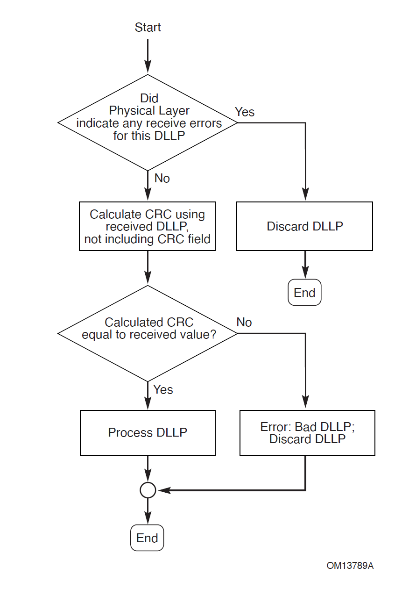
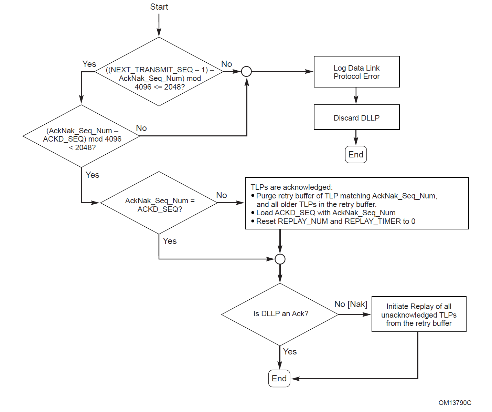

## 1 问题背景

PCIe Link是全双工链路。本端沿一个方向发送TLP时，对端会沿相反方向返回Ack/Nak和Flow Control信息。因此，Data Link Layer中的TLP发送机制不仅要维护发送序号、Retry Buffer和Flow Control Credit，还必须接收并处理来自对端的数据链路控制信息。

```text
本端                                          对端

TLP发送状态机 ───────────── TLP ─────────────→ TLP接收状态机
     ↑                                             │
     └────── Ack/Nak、Flow Control等控制信息 ──────┘
```

这些反向信息会直接改变本端后续的TLP发送行为：

- Ack推进累计确认边界并释放Retry Buffer。
- Nak请求发送端执行Replay。
- Flow Control更新可用Credit，决定哪些TLP能够继续发送。
- 链路管理类信息可能改变Data Link Layer的状态。

两种模式的控制目标相同，但接收载体和完整性检查边界不同：

> Non-Flit Mode接收的是具有独立边界和CRC-16的DLLP；Flit Mode首先接收并验证整个Flit，然后从固定的DLP区域中提取数据链路控制信息。

## 2 术语边界：DLLP与DLP不是同一个概念

在Non-Flit Mode中，`DLLP`是能够独立在线路上传输的数据链路层报文。它具有自己的帧边界和CRC-16，与TLP竞争链路发送机会。

在Flit Mode中，每个256 Byte Flit都包含6 Byte的`DLP`（Data Link Layer Payload）区域。该区域可以携带DLLP、`Optimized_Update_FC`或`Flit_Marker`等信息；Ack/Nak则使用专用DLP Symbols，不再作为独立Ack/Nak DLLP发送。

因此，描述实现时应区分以下两个动作：

```text
Non-Flit Mode：接收一个独立DLLP
Flit Mode    ：接收一个Flit → 验证Flit → 解释其中的DLP信息
```

不能把Flit中的6 Byte DLP区域简单理解成“带原有CRC-16的传统DLLP”。Flit Mode取消了TLP和DLLP各自携带的链路CRC，改由Flit级CRC统一保护TLP区域和DLP区域。

## 3 Non-Flit Mode的DLLP接收规则

### 3.1 接收流水线

Non-Flit Mode中的典型接收路径如下：

```text
Physical Layer交付DLLP
          ↓
是否指示Receiver Error？
    ├─ 是：丢弃当前DLLP，释放临时存储
    └─ 否
          ↓
对CRC字段之外的DLLP内容重新计算CRC-16
          ↓
计算结果是否等于接收CRC？
    ├─ 否：丢弃，记录并报告Bad DLLP
    └─ 是
          ↓
DLLP Type是否受支持？
    ├─ 否：静默丢弃，不视为错误
    └─ 是：忽略Reserved字段并按类型分发
```

该文字流程对应规范给出的DLLP接收状态图：



*图3-1：Non-Flit Mode的DLLP接收处理流程。图中的“Process DLLP”表示DLLP已经通过完整性检查，可以依据Type分发给相应消费者。*

### 3.2 Physical Layer报告Receiver Error

如果Physical Layer在接收过程中指示Receiver Error，Data Link Layer必须：

1. 丢弃当前正在接收的DLLP。
2. 释放为该DLLP分配的临时存储。
3. 不再继续执行DLLP CRC检查或类型解析。

这类错误由Physical Layer负责向软件报告，因此Data Link Layer不应再把同一个事件重复报告为Bad DLLP。

### 3.3 CRC-16检查

对于未被Physical Layer提前判定失败的DLLP，接收端使用与发送端相同的算法，对接收DLLP中除16-bit CRC字段以外的内容计算CRC，然后与报文携带的CRC字段比较。

```text
DLLP内容（不含CRC字段） ──→ CRC-16计算 ──→ calculated_crc
                                                  │
接收DLLP中的CRC字段 ──────────────────────────────┘
                                                  ↓
                                           相等 / 不相等
```

- 相等：DLLP通过链路完整性检查，可以继续解析。
- 不相等：DLLP损坏，必须丢弃；该事件属于与Port关联并需要报告的Bad DLLP错误。

一个损坏的Ack/Nak DLLP不会被部分采用。发送端如果因此长期得不到有效确认，最终可由`REPLAY_TIMER`超时触发重放。损坏的Flow Control DLLP同样不会更新本地Credit视图，后续累计Flow Control更新可以重新同步有效状态。

### 3.4 类型分发、Reserved字段和处理带宽

通过CRC检查后仍要遵守以下规则：

- DLLP Type编码不受本端支持时，静默丢弃，不产生错误。
- Reserved字段的值必须忽略，不能因为其非零而拒绝整个DLLP。
- 接收端必须按DLLP实际到达速率持续处理，不能要求对端停止发送DLLP。

其中，“处理DLLP”还包括把有效信息送到真正使用它的状态机：

| DLLP类型 | 主要消费者 | 对本端发送路径的影响 |
| --- | --- | --- |
| Ack/Nak | Data Link Layer的TLP发送与Replay逻辑 | 推进确认边界、释放Retry Buffer或启动Replay |
| Flow Control | Transaction Layer的发送流控逻辑 | 更新Credit，决定哪些TLP能够继续提交发送 |
| PM、链路管理及扩展DLLP | 对应的数据链路或管理状态机 | 推动相应协议状态 |

规范所说的“Received FC DLLPs are passed to the Transaction Layer”，强调的是功能归属，而不是把未经检查的线路字节直接旁路给Transaction Layer。实际路径应是：

```text
接收FC DLLP
    ↓
Data Link Layer完成Receiver Error、CRC和Type检查
    ↓
提取VC、Credit类型及Credit值
    ↓
通知Transaction Layer更新本端发送Credit视图
    ↓
Transaction Layer决定哪些TLP可以继续发送
```

> **question：为什么DLLP处理能力必须跟上实际到达速率？**
>
> DLLP本身没有接收Credit，也没有让接收端对其施加反压的协议机制。如果长期处理速率低于到达速率，内部队列最终必然溢出，继而丢失Ack/Nak、Flow Control或链路管理信息，造成Retry Buffer不能及时释放、`REPLAY_TIMER`超时、Credit视图滞后或状态机停滞。因此接收端的长期服务率必须不低于最坏情况下的DLLP到达率。

这里的“按到达速率处理”不要求所有后端动作都在一个周期内完成。实现可以采用流水线和有限深度FIFO吸收短期仲裁抖动，但平均处理能力仍必须跟上输入：

```text
PHY接收 → CRC/Type检查 → DLLP分发FIFO
                              ├─ Ack/Nak Handler
                              ├─ Flow Control Handler → Transaction Layer
                              └─ Other DLLP Handler
```

静默丢弃未知类型与忽略Reserved字段都是协议向前兼容机制：新一代设备可以定义旧设备尚不了解的功能，而不会让旧设备把每个未知编码都升级成链路故障。

### 3.5 Ack/Nak的序号检查与累计确认

有效的Ack/Nak DLLP不能在CRC通过后立即修改Retry Buffer。发送端还必须检查`AckNak_Seq_Num`是否位于当前合法确认窗口：

```text
合法AckNak_Seq_Num
    = 当前ACKD_SEQ
      或
      Retry Buffer中某个尚未确认TLP的序号
```

如果序号既不等于`ACKD_SEQ`，也不对应任何尚未确认的TLP，则必须丢弃该Ack/Nak DLLP，不允许释放Retry Buffer或启动由该DLLP请求的Replay。该事件属于与Port关联并需要报告的Data Link Protocol Error。

当Retry Buffer为空时，收到Ack本身并不是错误，包括Reset之后、发送第一个TLP之前的阶段；只要`AckNak_Seq_Num`仍等于当前`ACKD_SEQ`即可。这样的Ack没有推进确认边界，因此不会释放任何条目。

序号通过合法性检查后，按照下面的顺序处理：

```text
接收有效Ack/Nak DLLP
          ↓
AckNak_Seq_Num是否合法？
    ├─ 否：丢弃DLLP，报告Data Link Protocol Error
    └─ 是
          ↓
AckNak_Seq_Num是否等于ACKD_SEQ？
    ├─ 是：累计确认边界不变
    └─ 否
          ├─ 从最老TLP开始，释放至AckNak_Seq_Num对应条目
          ├─ ACKD_SEQ ← AckNak_Seq_Num
          ├─ REPLAY_NUM复位
          └─ REPLAY_TIMER复位
          ↓
该DLLP是否为Nak？
    ├─ 否：处理结束
    └─ 是：对剩余的未确认TLP启动Replay
```

规范给出的完整处理流程如下：



*图3-2：Non-Flit Mode的Ack/Nak DLLP接收流程。前两个模4096比较共同判断`AckNak_Seq_Num`是否位于当前合法确认窗口；序号非法时报告Data Link Protocol Error并丢弃DLLP。*

图中的两个序号条件可以理解为对合法窗口两端的检查：`AckNak_Seq_Num`既不能越过最近已经发送的TLP，也不能落到当前`ACKD_SEQ`之后的旧序号区域。模4096运算用于正确处理12-bit序号从`FFFh`回卷到`000h`的情况，`2048`则用于消除环形序号空间中的前后方向歧义。

Ack和Nak都具有累计确认语义。两者的区别不在释放规则，而在完成累计确认之后是否要求重放：

| DLLP | 累计确认处理 | 后续动作 |
| --- | --- | --- |
| Ack | 释放至`AckNak_Seq_Num`对应的TLP | 不启动Replay |
| Nak | 释放至`AckNak_Seq_Num`对应的TLP | 从下一条仍未确认的TLP开始Replay |

例如，发送端状态为：

```text
ACKD_SEQ     = 10
Retry Buffer = 11、12、13、14、15
```

收到`Ack 13`时：

```text
释放11、12、13
ACKD_SEQ ← 13
REPLAY_NUM和REPLAY_TIMER复位
Retry Buffer剩余14、15，继续等待确认
```

收到`Nak 13`时，首先执行完全相同的累计释放，然后启动Replay：

```text
释放11、12、13
ACKD_SEQ ← 13
REPLAY_NUM和REPLAY_TIMER复位
从14开始重放剩余的14、15
```

因此，`Nak 13`的含义不是“从13开始重放”，而是“序号13及其之前的TLP已经累计确认，请重放13之后仍未确认的TLP”。

如果收到`Nak 10`，由于序号等于当前`ACKD_SEQ`，不会释放新的条目，但Nak仍然要求从最老的未确认TLP 11开始Replay。重复的`Ack 10`则合法但不会产生新的状态变化。

| 当前状态下收到的DLLP | 是否推进确认边界 | 是否释放新条目 | 是否启动Replay |
| --- | --- | --- | --- |
| `Ack == ACKD_SEQ` | 否 | 否 | 否 |
| Ack指向未确认窗口中的TLP | 是 | 累计释放至Ack序号 | 否 |
| `Nak == ACKD_SEQ` | 否 | 否 | 是，从最老未确认TLP开始 |
| Nak指向未确认窗口中的TLP | 是 | 累计释放至Nak序号 | 是，从其下一条开始 |

这里对序号是否位于确认窗口的判断必须采用12-bit序号空间的回卷规则，不能直接使用普通整数的大小比较。确认边界推进后复位`REPLAY_NUM`，是因为发送端已经观察到新的传输进展；`REPLAY_TIMER`也要以当前最老的未确认TLP为基准，按照协议规则重新建立计时状态。

## 4 Flit Mode的数据链路控制信息接收规则

### 4.1 完整性边界从DLLP变成Flit

Flit Mode使用固定256 Byte传输单元，其基本区域为：

| 区域 | 大小 | 接收侧作用 |
| --- | ---: | --- |
| TLP区域 | 236 Byte | 承载一个或多个TLP；TLP也可以跨Flit |
| DLP区域 | 6 Byte | 承载数据链路控制信息 |
| CRC | 8 Byte | 检测TLP区域和DLP区域中的残余错误 |
| FEC | 6 Byte | 对整个Flit进行低延迟纠错 |

接收端不能一看到DLP字节就立即更新Ack状态或Credit，因为这些字节尚未通过完整的Flit级保护。正确顺序是先纠错、后检查、最后提交：

```text
接收完整Flit
     ↓
FEC Decode / Correction
     ↓
Flit CRC检查
 ├─ 失败：进入Flit错误与Replay处理，不解释其中DLP
 └─ 通过
      ↓
提取6 Byte DLP区域
      ↓
解析Ack/Nak Symbols、DLLP、Optimized_Update_FC或Flit_Marker
      ↓
提交到Replay、Flow Control或其他控制状态机
```

这相当于实现中的事务提交边界：只有Flit完整性成立后，DLP信息才允许对架构状态产生影响。

### 4.2 Flit内不再检查独立DLLP CRC-16

Flit Mode中的TLP和数据链路控制信息由Flit级CRC和FEC共同保护，不再各自携带Non-Flit格式中的链路CRC。因此接收路径不应在DLP区域内部再次查找传统DLLP CRC-16。

当Flit CRC失败时，接收端首先知道的是“这个Flit不可信”，而不是“其中某个独立DLLP发生CRC-16错误”。此时不能使用损坏Flit中的Ack、Nak或Credit值，否则可能错误释放Retry Buffer或允许超出Credit的TLP继续发送。

### 4.3 Ack/Nak使用专用DLP Symbols

每个Flit都为Ack/Nak提供专用DLP位置，使反向确认带宽能够与Flit到达速率匹配。因此：

- Ack/Nak不需要等待当前方向的TLP结束后再插入一个独立DLLP。
- DLP信息与同一个Flit中的TLP内容没有语义依赖，即使没有新的事务层TLP，也仍可传递必要的控制状态。
- 接收端在Flit通过检查后，直接把Ack/Nak Symbols分发给Flit Replay状态机。
- Ack/Nak确认的是Payload Flit序列，而不是Non-Flit Mode中的TLP Data Link Sequence Number。

### 4.4 Flow Control与其他DLP信息

Flit的DLP区域还可以承载DLLP、`Optimized_Update_FC`或`Flit_Marker`。接收端应先按DLP内容类别解码，再分发到对应消费者：

```text
有效DLP区域
   ├─ Ack/Nak Symbols       → Flit Replay接收状态机
   ├─ Flow Control信息      → Credit状态机
   ├─ Flit_Marker           → 对应TLP/Flit处理上下文
   └─ 其他DLLP              → PM、链路管理或扩展功能状态机
```

如果在完整性有效的Flit中出现本端不支持的DLLP Type，仍应按该类型的协议规则决定是否静默丢弃；Reserved字段仍不能被用作拒绝有效控制信息的理由。

## 5 两种模式的核心差异

| 对比项 | Non-Flit Mode | Flit Mode |
| --- | --- | --- |
| 线路接收对象 | 独立DLLP | 固定长度Flit中的DLP区域 |
| 控制信息边界 | DLLP自身边界 | Flit边界先成立，再解析DLP |
| 完整性保护 | 每个DLLP独立CRC-16 | 整个Flit的FEC与64-bit CRC |
| Ack/Nak载体 | Ack/Nak DLLP | 专用DLP Symbols |
| Ack/Nak确认对象 | TLP Data Link Sequence Number | Payload Flit序列 |
| Flow Control载体 | 独立InitFC/UpdateFC等DLLP | DLP区域中的DLLP或Optimized_Update_FC |
| 错误隔离粒度 | 当前DLLP | 当前Flit |
| CRC失败后的动作 | 丢弃DLLP并报告Bad DLLP | 不解释该Flit中的DLP，进入Flit错误/Replay路径 |
| 与正向TLP发送的竞争 | DLLP需要参与链路发送仲裁 | 每个Flit具有固定DLP带宽 |
| 接收吞吐要求 | 按DLLP到达速率处理 | 每接收一个Flit都要及时解析其DLP区域 |

最关键的差异不是“字段换了一个位置”，而是**可信边界发生了变化**：

```text
Non-Flit：DLLP CRC通过 → DLLP可信 → 更新状态
Flit    ：Flit FEC/CRC通过 → DLP可信 → 更新状态
```

## 6 推荐的RTL实现分层

两种模式可以共享后端状态机，但不应强行共享完全相同的接收前端。

```text
                  ┌─ Non-Flit DLLP Deframer
Physical RX ──────┤       + DLLP CRC-16 Check ─┐
                  │                            │
                  └─ Flit Buffer              ├─→ 统一控制信息接口
                      + FEC/CRC Check          │      ├─ Ack/Nak Handler
                      + DLP Extractor ─────────┘      ├─ FC Handler
                                                     └─ Other DLLP Handler
```

统一控制信息接口可以使用类似下面的内部事务：

```text
valid
class          // ACK_NAK、FLOW_CONTROL、PM、MARKER、OTHER
payload
source_mode    // NON_FLIT或FLIT
integrity_ok
unsupported
```

实现时应特别保证：

1. `integrity_ok`成立前，任何Ack/Nak或Credit都不能提交。
2. CRC失败、未知Type和Reserved字段异常必须是三条不同处理路径。
3. Replay期间仍要持续处理反向Ack/Nak，不能因为发送端正在重放而关闭接收路径。
4. 接收前端需要提供足够吞吐率，避免控制信息内部排队导致Ack、Replay或Credit状态过期。
5. 错误报告必须去重，避免把一个Physical Receiver Error再次记录成Bad DLLP。

## 7 容易混淆的几个问题

### 7.1 Flit Mode完全没有DLLP吗？

不是。部分传统数据链路功能仍可以通过Flit的DLP区域携带DLLP，但Ack/Nak使用的是专用DLP Symbols，Flow Control还可以使用`Optimized_Update_FC`。因此不能把“DLP”与“DLLP”作为完全相同的词使用。

### 7.2 Flit中的DLP是否需要再做一次CRC-16？

不需要。DLP区域已经包含在Flit级CRC和FEC保护范围内。只有整个Flit通过检查后，接收端才解释DLP内容。

### 7.3 未知DLLP Type与CRC错误是否等价？

不等价。CRC错误表示接收内容不可信，需要丢弃并按错误规则处理；未知但完整性有效的Type是兼容性问题，通常静默丢弃。

### 7.4 为什么必须按到达速率处理控制信息？

因为Ack/Nak和Credit决定了相反方向的TLP能否继续发送。控制接收路径如果吞吐不足，会间接造成Retry Buffer无法释放、Replay超时或发送Credit停顿。Flit Mode中每个Flit都带有DLP区域，这使持续、定速的DLP解析更加重要。

## 8 总结

接收数据链路控制信息时，首先要判断当前Link采用哪一种传输模式：

- Non-Flit Mode以独立DLLP为检查和处理单元，先处理Physical Receiver Error，再校验DLLP CRC-16，最后执行类型解析。
- Flit Mode以整个Flit为可信边界，先执行FEC纠错和Flit CRC检查，成功后才提取DLP区域；Ack/Nak使用专用DLP Symbols。
- 两种模式最终都会把有效控制信息送入Replay、Flow Control和链路管理状态机，但前端封装、CRC边界、错误粒度和接收带宽模型不同。

实现和验证时可以始终追踪三个问题：**当前校验单元是什么、何时允许控制信息提交、错误发生时应丢弃DLLP还是整个Flit**。

## 9 参考资料

- PCI Express Base Specification：Data Link Layer、DLLP Receive Rules及Flit Mode相关章节。
- [PCI-SIG：The Evolution of the PCI Express Specification](https://pcisig.com/blog/evolution-pci-express-specification-its-sixth-generation-third-decade-and-still-going-strong)
- [PCI-SIG：PCIe 6.0 Flit Mode、PAM4与FEC Webinar Q&A](https://pcisig.com/blog/pcie%C2%AE-60-specification-webinar-qa-deeper-dive-flit-mode-pam4-and-forward-error-correction-fec)
- [PCI-SIG：PCIe 6.0 Specification](https://pcisig.com/pci-express-6.0-specification)
