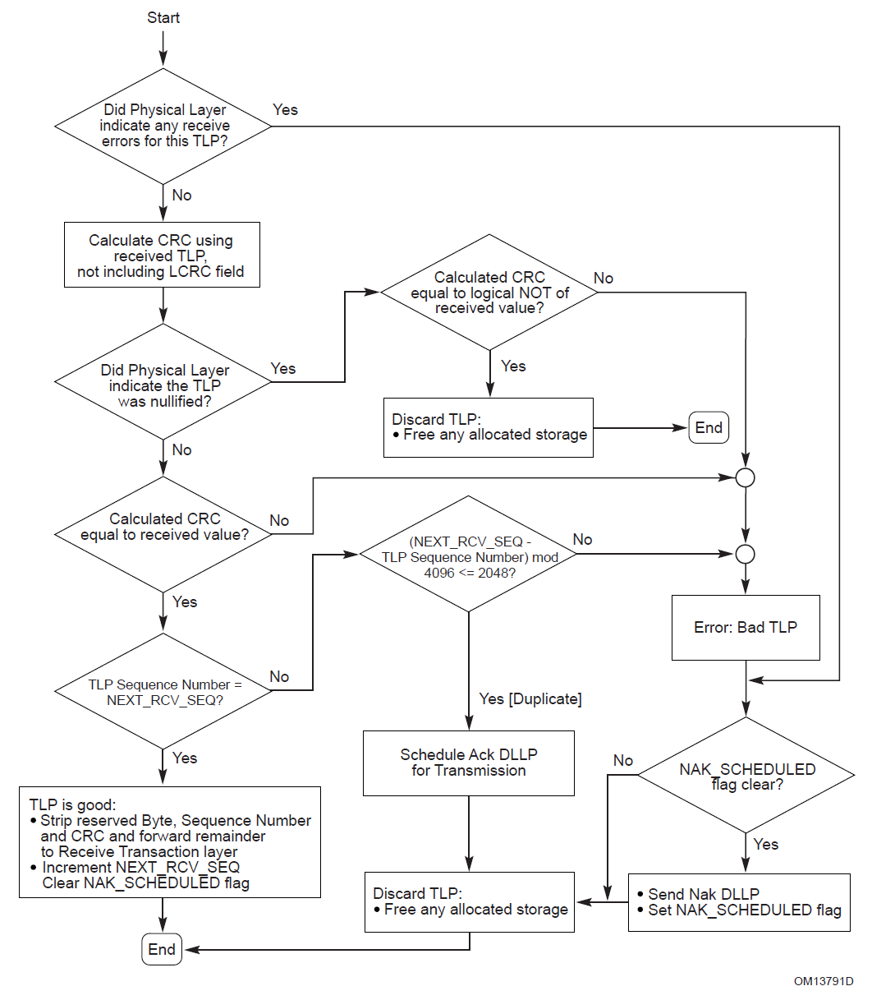

## 1 TLP接收路径总览

Physical Layer将收到的TLP交给Data Link Layer。Data Link Layer检查LCRC和TLP Sequence Number：检查通过后将TLP交给Receive Transaction Layer；检测到可恢复的传输损坏时丢弃TLP，并通过Nak请求对端从Retry Buffer执行Replay。

```text
Physical Layer接收TLP
        ↓
检查LCRC与Sequence Number
   ├─ 通过：交付Transaction Layer
   └─ 损坏：丢弃并请求Replay
```

规范通过概念性的计数器和标志描述这些行为，仅用于澄清协议要求，并不强制具体实现。RTL可以采用寄存器、FSM、FIFO指针或其他结构，只要外部行为符合规范即可。

## 2 接收端概念状态

规范使用以下计数器、标志和计时器描述接收端行为：

| 状态 | 作用 | 进入`DL_Inactive`时 |
| --- | --- | --- |
| `NEXT_RCV_SEQ` | 12-bit计数器，保存下一个期望接收的TLP Sequence Number | 置为`000h` |
| `NAK_SCHEDULED` | 表示当前是否已经调度Nak，避免对同一错误重复调度 | 清零 |
| `AckNak_LATENCY_TIMER` | 决定何时必须调度Ack DLLP | 置为0 |

`AckNak_LATENCY_TIMER`遵循以下规则：

- 每次调度Ack或Nak DLLP时，从0重新开始计时。
- 当所有已接收TLP都已经由Ack确认时，复位为0。
- 如果此前没有待确认TLP，则收到第一个新TLP后，只有当该TLP已经转交Receive Transaction Layer时才开始计时。

```text
无待确认TLP
      ↓
正确接收并向Receive Transaction Layer转交TLP
      ↓
AckNak_LATENCY_TIMER开始计时
      ↓
满足调度条件
      ↓
调度Ack或Nak，并从0重新计时
```

这里的“调度”表示把Ack/Nak提交给发送仲裁逻辑，并不等同于该DLLP已经在线路上发送完成。

## 3 TLP接收与Ack/Nak调度规则

### 3.1 TLP接收规则

接收端按以下顺序处理TLP，前一阶段已经决定丢弃时，不再继续解释后续字段：

1. **Physical Receiver Error**：丢弃当前TLP并释放缓存，错误由Physical Layer上报。如果当时正在接收TLP且`NAK_SCHEDULED=0`，立即调度Nak并置位该标志。
2. **Nullified TLP**：如果接收LCRC等于计算结果的逻辑反相，则合法丢弃，不算错误；否则按Bad TLP处理，并在尚未调度Nak时立即调度Nak。
3. **LCRC检查**：使用除接收LCRC字段之外的TLP内容重新计算LCRC。比较失败时丢弃TLP、报告Bad TLP，并在`NAK_SCHEDULED=0`时调度Nak。
4. **Sequence Number检查**：只有LCRC正确后，才将接收序号与`NEXT_RCV_SEQ`比较。

当接收序号不等于`NEXT_RCV_SEQ`时，先丢弃TLP，再区分重复包与乱序包：

```text
(NEXT_RCV_SEQ - Received_SEQ) mod 4096 <= 2048
```

- 条件成立：属于Replay产生的重复TLP，不重复交付Transaction Layer，并调度当前累计Ack。
- 条件不成立：属于Out-of-Sequence TLP，表示可能丢失了一个或多个TLP；报告Bad TLP，并在尚未调度Nak时立即调度Nak。如果Nak已经调度，规范允许但不推荐重复报告Bad TLP。

当接收序号等于`NEXT_RCV_SEQ`时，移除前面的4-bit字段、Sequence Number和尾部LCRC，将剩余TLP转交Receive Transaction Layer，然后递增`NEXT_RCV_SEQ`并清除`NAK_SCHEDULED`。

Data Link Layer只负责指示TLP起点和终点，将事务层内容视为黑盒，不解析或修改其内容。Receiver Flow Control也只有在TLP实际转交Receive Transaction Layer时，才把它计入接收状态。



*图3-1：Non-Flit Mode的TLP接收流程。接收端依次处理Physical Receiver Error、Nullified TLP、LCRC和Sequence Number，并根据结果交付TLP、调度Ack或调度Nak。*

| 接收结果 | TLP处理 | Ack/Nak | 错误报告 |
| --- | --- | --- | --- |
| Physical Receiver Error | 丢弃 | 首次调度Nak | Physical Layer负责 |
| 合法Nullified TLP | 丢弃 | 无 | 无 |
| Nullified编码错误或Bad LCRC | 丢弃 | 首次调度Nak | Bad TLP |
| 合法重复序号 | 丢弃，不重复交付 | 调度Ack | 无 |
| Out-of-Sequence | 丢弃 | 首次调度Nak | Bad TLP |
| LCRC正确且序号符合预期 | 交付Transaction Layer | 按延迟规则调度Ack | 无 |

### 3.2 Ack DLLP的最迟调度条件

当以下条件同时成立时，Ack DLLP必须能够及时发送，不能继续因内部仲裁而推迟：

- Data Link Control and Management State Machine处于`DL_Active`。
- 已有TLP转交Receive Transaction Layer，但尚未通过Ack确认。
- `AckNak_LATENCY_TIMER`达到或超过当前数据速率对应的Ack Latency Limit。
- 用于发送Ack的Link已经处于`L0`；如果不在`L0`，必须请求返回`L0`。
- 该方向当前没有正在发送的TLP或DLLP。
- `NAK_SCHEDULED=0`。

```text
DL_Active && 存在待确认TLP && Timer到期
&& Link处于L0 && 发送方向空闲 && !NAK_SCHEDULED
                         ↓
                 Ack不得继续推迟
```

已经开始发送的TLP或DLLP不能被Ack中途打断，可以先完整发送；链路空闲后必须及时发送Ack。规范允许实现比最低要求更频繁地调度Ack，以降低确认延迟。

每次Ack或Nak DLLP被调度时，`AckNak_LATENCY_TIMER`都从0重新开始。两类DLLP携带相同的累计确认边界：

```text
AckNak_Seq_Num = (NEXT_RCV_SEQ - 1) mod 4096
```

Ack只表示该边界及以前的TLP已连续正确接收；Nak在表达相同确认边界的同时，请求发送端Replay之后仍未确认的TLP。

总的来说，Non-Flit Mode接收端先用LCRC确认TLP内容可信，再用Sequence Number区分新TLP、重复TLP和乱序TLP；只有正确且序号符合预期的TLP才会交付Transaction Layer并推进`NEXT_RCV_SEQ`。Ack/Nak则统一携带`NEXT_RCV_SEQ - 1`作为累计确认边界，在限制时间内把接收结果反馈给发送端，从而形成完整的链路可靠传输闭环。

## Appendix A：L0s状态

`L0s`是PCIe Link的单方向浅度低功耗状态。某个发送方向暂时空闲时可以从`L0`进入`L0s`，而反方向仍可保持正常传输；Sequence Number、Retry Buffer和Flow Control状态不会因此清除。

当该方向需要发送Ack DLLP时，Link必须先通过FTS恢复同步并返回`L0`，然后才能发送Ack。该过程产生`L0s Exit Latency`；若`Extended Synch=1`，FTS长度增加，退出延迟也会变长。合规测试会允许这部分延迟，Data Link Layer不需要据此调整Ack调度计时器。
