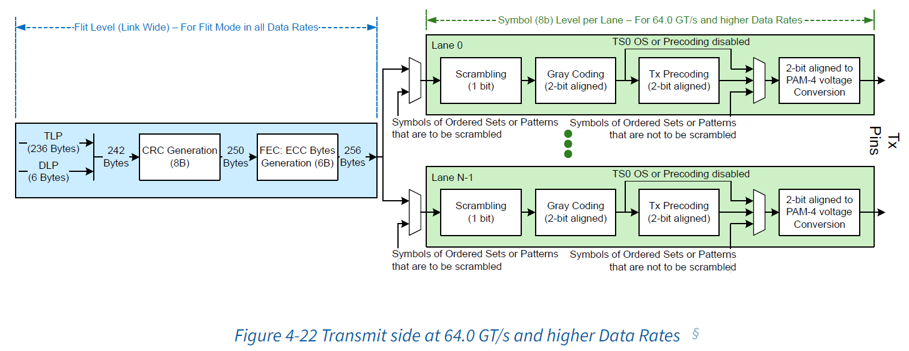
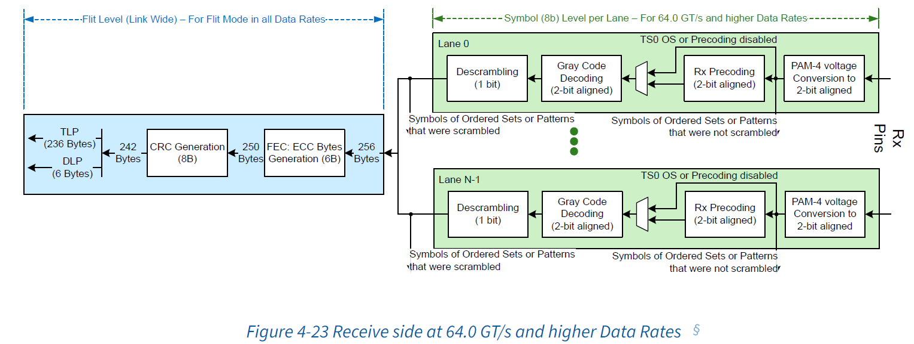

## 1 PCIe 7.0 §4.2.3内容总览

根据PCI Express Base Specification Revision 7.0完整PDF中的书签，§4.2.3 **Flit Mode Operation**位于规范第394～464页，主要分为以下四部分：

| 规范章节 | 页码范围 | 主要内容 |
| --- | ---: | --- |
| §4.2.3.1 1b/1b Encoding for 64.0 GT/s and Higher Data Rates | 394～403 | 说明64.0 GT/s及更高速率下的1b/1b编码，包括PAM4、1b/1b加扰、Gray Coding、Precoding、Ordered Set Block，以及Block/Flit边界对齐。 |
| §4.2.3.2 Processing of Ordered Sets During Flit Mode Data Stream | 404～405 | 说明Flit数据流中Ordered Set的识别和处理规则，以及Ordered Set与正常Flit数据流之间的切换。 |
| §4.2.3.3 Data Stream in Flit Mode | 406～411 | 说明256 Byte Flit在不同Link Width下的发送形式、Lane映射，以及发送端与接收端的数据处理路径。 |
| §4.2.3.4 Bytes in Flit Layout | 412～464 | 定义Flit内部各字节的用途，包括TLP Bytes、DLP Bytes、Sequence Number与Retry、NOP Flit、CRC、ECC，以及Flit数据流中的Ordered Set插入。 |

上述页码取自完整规范PDF的书签。范围按“本节起始页至下一同级小节起始页的前一页”统计。

### 1.1 Replay相关内容的位置

Flit Mode Replay集中在§4.2.3.4.2.1 **Flit Sequence Number and Retry Mechanism**，对应规范第419～444页：

| 规范章节 | 起始页 | 内容 |
| --- | ---: | --- |
| §4.2.3.4.2.1 | 419 | Flit Sequence Number、Retry Buffer、Ack/Nak及Replay机制的总体规则 |
| §4.2.3.4.2.1.1 | 425 | IDLE Flit Handshake Phase |
| §4.2.3.4.2.1.2 | 426 | Sequence Number Handshake Phase |
| §4.2.3.4.2.1.3 | 427 | Normal Flit Exchange Phase |
| §4.2.3.4.2.1.4 | 429 | Received Ack and Nak Processing |
| §4.2.3.4.2.1.5 | 430 | Ack、Nak和Flit丢弃规则 |
| §4.2.3.4.2.1.6 | 437 | Flit Replay Scheduling |
| §4.2.3.4.2.1.7 | 438 | Flit Replay Transmit Rules |

因此，理解Flit Mode Replay时，可以先阅读第419～424页的概念、计数器和总体规则，再按照握手阶段、正常传输、Ack/Nak处理、Replay调度与Replay发送规则的顺序继续阅读。

## 2 Flit发送端与接收端的处理顺序

§4.2.3.1使用概念框图规定发送端和接收端必须表现出的处理顺序，但不限制实现内部的数据通路位宽。实现可以采用8 bit、32 bit或更宽的并行通路，只要处理结果和规定顺序等价即可。

处理过程可以分成两个层次：

- **Flit级处理**：面向完整256 Byte Flit，在整个Link宽度上完成CRC、FEC以及各Lane之间的Byte Interleaving。
- **每Lane处理**：面向分配到单条Lane上的8-bit Symbol，在64.0 GT/s及更高速率下完成Scrambling、Gray Coding、Precoding和PAM4映射。

### 2.1 发送端处理顺序

发送端首先将236 Byte TLP区域与6 Byte DLP区域组成242 Byte受保护内容，然后依次生成8 Byte CRC和6 Byte FEC/ECC，形成完整的256 Byte Flit。完整Flit随后按照Byte Interleaving规则分配到各条Lane，再执行每Lane物理编码。

```text
TLP区域（236 B）+ DLP区域（6 B）
                ↓
          生成CRC（8 B）
                ↓
        生成FEC/ECC（6 B）
                ↓
       得到完整256 Byte Flit
                ↓
  Byte Interleaving并分配到各Lane
                ↓
 Scrambling → Gray Coding → Precoding
                ↓
            PAM4电平映射
```



*图2-1：64.0 GT/s及更高速率下的发送端概念路径。蓝色区域是完整Flit上的处理，绿色区域是每条Lane独立完成的Symbol处理。*

其中，Gray Coding与Precoding均以2-bit边界处理。对于`S7S6S5S4S3S2S1S0`形式的8-bit Symbol，处理单位依次为`S1:S0`、`S3:S2`、`S5:S4`和`S7:S6`，每组2 bit最终映射为一个PAM4 UI。

### 2.2 接收端处理顺序

接收端执行与发送端相反的过程。每条Lane首先把PAM4电平恢复成2-bit数据，然后解除Precoding、Gray Coding和Scrambling。各Lane的数据重新组合成256 Byte Flit后，接收端先使用FEC信息检测并纠正错误，再检查CRC。

```text
          接收PAM4电平
                ↓
 PAM4解码 → 解除Precoding → Gray Decoding
                ↓
            Descrambling
                ↓
       合并各Lane并恢复Flit
                ↓
         FEC检测与错误纠正
                ↓
              CRC检查
                ↓
      提取TLP区域和DLP区域
```



*图2-2：64.0 GT/s及更高速率下的接收端概念路径。图中数据从右向左流动；FEC处理先于CRC检查，以便CRC检查已经完成纠错的Flit。*

FEC与CRC的职责不同：FEC负责快速纠正能力范围内的传输错误，CRC负责判断纠错后的Flit是否仍存在残留错误。如果FEC处理后CRC仍不匹配，该Flit不能向上交付，需要按照后续Ack/Nak与Replay规则处理。

> **为什么增加Gray Coding？**
>
> PAM4包含4个电压等级，通道噪声和抖动最容易使接收端把某个电平误判成相邻电平。Gray Coding使相邻电平的编码仅相差1 bit，例如按`00 → 01 → 11 → 10`的顺序映射。这样，相邻电平误判通常只产生1 bit错误，可以减轻FEC的纠错压力，并降低Flit因不可纠正错误而触发Replay的概率。Gray Coding减少的是相邻电平之间的编码bit差异，并不保证减少连续UI之间的电压跳变；数据随机化和频谱控制主要由Scrambling负责。

### 2.3 Flit与Ordered Set的路径差异

并非所有Symbol都经过完全相同的逻辑：

| Symbol来源 | Scrambling | Gray Coding | Precoding | PAM4编码 |
| --- | --- | --- | --- | --- |
| Flit Data Stream | 按规定执行 | 执行 | 启用且要求时执行 | 执行 |
| Ordered Set或测试Pattern中的Scrambled部分 | 执行 | 执行 | 经过Precoding逻辑，包括需要时的Bypass | 执行 |
| Ordered Set或测试Pattern中的Unscrambled部分 | 不执行 | 不再额外执行 | 按规定绕过 | 执行 |

Unscrambled Ordered Set之所以不再额外执行Gray Coding，是因为其Symbol定义已经考虑了Gray特性和DC Balance要求。不过，无论Symbol来自Flit还是Ordered Set，最终都必须转换为PAM4电平后才能在线路上传输。

## 3 Flit Sequence Number Rules

Flit Mode使用10-bit Flit Sequence Number跟踪Payload Flit，并以Flit为单位完成确认与Replay。虽然字段宽度是10 bit，但Payload Flit的有效序号只有`1～1023`，序号`0`专门用于IDLE Flit。

### 3.1 有效序号与回绕

Payload Flit的Sequence Number按照以下序列循环：

```text
1 → 2 → 3 → ... → 1022 → 1023 → 1 → 2 → ...
```

也就是说，计数器从`1023`回绕到`1`，不会回绕到`0`。本节中所有序号的加、减、递增和递减，都隐含遵循这一回绕规则。可以将递增操作理解为：

```text
next(N) = (N == 1023) ? 1 : N + 1
```

### 3.2 Payload Flit消耗序号

`NEXT_TX_FLIT_SEQ_NUM`保存下一个新Payload Flit应当使用的序号，在`DL_Inactive`状态中初始化为`001h`。发送一个不是从TX Retry Buffer重放的新Payload Flit后，该计数器递增。

```text
初始NEXT_TX_FLIT_SEQ_NUM = 1

发送Payload A：Seq = 1  → NEXT = 2
发送Payload B：Seq = 2  → NEXT = 3
发送Payload C：Seq = 3  → NEXT = 4
```

发送以下内容时，`NEXT_TX_FLIT_SEQ_NUM`不变：

- IDLE Flit；
- NOP Flit；
- 从TX Retry Buffer发送的Replay Flit。

Replay Flit必须保持首次发送时保存的Sequence Number，不能因为重新发送而分配新序号，否则接收端无法把Replay与原来的未确认Flit对应起来。

### 3.3 NOP Flit不消耗序号

NOP Flit不会推进Flit Sequence Number。如果NOP Flit采用Explicit Sequence Number格式，其Sequence Number填写为：

```text
NEXT_TX_FLIT_SEQ_NUM - 1
```

因此，它实际上携带最近一次发送的Payload Flit序号：

```text
Payload Seq 10 → NOP → NOP → Payload Seq 11
                 │     │
                 └─────┴─ Explicit Seq均可填写10
```

如果链路初始化后还没有发送过任何Payload Flit，此时`NEXT_TX_FLIT_SEQ_NUM`为`1`，按照回绕规则，Explicit NOP使用序号`1023`。

当`REPLAY_IN_PROGRESS = 1b`时，如果发送Explicit NOP，规范强烈建议其Explicit Sequence Number设置为最近发送的Payload Flit序号。这样显式序号能够继续反映当前Replay进度，而不会被NOP本身推进。

### 3.4 IDLE Flit使用序号0

Sequence Number `0`只用于IDLE Flit，用来支持IDLE Flit Handshake Phase。它不属于正常Payload序号空间，也不能作为普通Payload Flit的Sequence Number。

```text
IDLE Flit     ：Seq = 0
Payload Flit  ：Seq = 1～1023
```

因此，接收端看到Explicit Payload Flit携带序号`0`时，不能把它解释为正常的回绕结果。

### 3.5 SKP Ordered Set不打断Flit连续性

两个发送或接收的Flit即使中间插入了SKP Ordered Set，在Sequence Number语义上仍被视为连续Flit：

```text
Payload Flit Seq N
        ↓
   SKP Ordered Set
        ↓
Payload Flit Seq N+1
```

SKP只用于Physical Layer的Clock Compensation，不是Flit，也不参与Flit Sequence Number计数。因此接收端检查Flit序号连续性时需要忽略中间插入的SKP Ordered Set。

### 3.6 规则总结

| 发送对象 | 使用的Sequence Number | 是否推进`NEXT_TX_FLIT_SEQ_NUM` |
| --- | --- | --- |
| 新Payload Flit | 当前`NEXT_TX_FLIT_SEQ_NUM` | 是 |
| Replay Payload Flit | TX Retry Buffer中保存的原序号 | 否 |
| Explicit NOP Flit | `NEXT_TX_FLIT_SEQ_NUM - 1` | 否 |
| IDLE Flit | `0` | 否 |
| SKP Ordered Set | 不属于Flit序号空间 | 否 |

Flit Sequence Number的核心作用是建立Payload Flit的可靠传输顺序。只有首次发送的新Payload Flit消耗新序号；NOP、IDLE、SKP和Replay都不会推进新的Payload确认边界。

## 4 Sequence Number Handshake的原因与流程

Flit Mode在进入Normal Flit Exchange之前，需要先通过Sequence Number Handshake让两个方向分别建立可靠的10-bit Flit Sequence Number基准。该阶段位于IDLE Flit Handshake之后，并允许Data Link Feature Exchange和Flow Control Initialization并行进行。

### 4.1 为什么需要Sequence Number Handshake

Flit Mode不会在每个Flit中都传递当前Flit的完整10-bit Sequence Number。固定的DLP区域还需要承载Ack、Nak、Flow Control和Replay Command，因此当前Flit的Explicit Sequence Number与Ack/Nak采用互斥编码：

| Replay Command | 当前Flit的控制含义 | Sequence Number字段的含义 |
| ---: | --- | --- |
| `00b` | Explicit Sequence Number Flit | 当前Flit的完整Sequence Number |
| `01b` | Ack Flit | 需要确认的对端Flit Sequence Number |
| `10b` | Standard Nak Flit | Standard Nak对应的Sequence Number |
| `11b` | Selective Nak Flit | Selective Nak对应的Sequence Number |

所以，一个Flit不能同时携带当前Flit的完整Explicit Sequence Number和Ack/Nak。Normal Flit Exchange中，接收端通常以最近收到的Explicit Sequence Number为基准，结合Payload或NOP属性维护`IMPLICIT_RX_FLIT_SEQ_NUM`。

链路刚从Configuration或Recovery进入L0时，如果双方没有先建立共同的显式基准，后续隐式序号可能出现歧义，进而产生错误的Ack/Nak、错误的Replay范围或不必要的Recovery。因此握手需要证明两个事实：

1. 本端已经多次发送自己的Explicit Sequence Number，使对端有足够机会获得本端基准；
2. 本端已经收到对端的Explicit Sequence Number，并通过Ack多次反馈已经获得该基准。

### 4.2 从IDLE阶段进入握手阶段

当LTSSM进入`Configuration.Idle`或`Recovery.Idle`时，端口进入IDLE Flit Handshake Phase：

- 发送端按照LTSSM规则发送IDLE Flit；
- 发送端在LTSSM进入L0时转入Sequence Number Handshake Phase；
- 接收端在连续收到两个有效IDLE Flit后转入Sequence Number Handshake Phase；
- IDLE阶段收到的Flit被丢弃，不作为正常Payload处理。

该过程先确认两端已经观察到有效IDLE边界，再开始交换非零Sequence Number，避免新旧Data Stream状态混淆。

### 4.3 双向独立的发送节奏

握手阶段中，每个方向的发送端按照以下节奏工作：

```text
Explicit → Explicit → Explicit → Ack/Nak
    E          E          E          A/N
```

三个Explicit Flit之后，第四个Flit按照以下优先级选择：

```text
Standard Nak > Selective Nak > Ack
```

如果没有Nak需要发送，第四个Flit就是Ack；随后发送端直接开始下一组三个Explicit Flit，并不停止等待对端回复。A和B两个方向并行、独立执行：

```text
A → B：EEE A/N → EEE A/N → EEE A/N → ...
B → A：EEE A/N → EEE A/N → EEE A/N → ...
```

A发送的Ack/Nak反馈的是A在`B → A`方向收到的Flit，而不是B专门对A刚发送的三个Explicit Flit作出的同步应答。因此，这不是“一组报文发送完后等待对端回应”的停等协议。

正常情况下每组恰好包含三个连续Explicit Sequence Number Flit。如果`CONSECUTIVE_TX_EXPLICIT_SEQ_NUM_FLITS`因Replay Schedule Rule 0被重置，规范允许最多连续发送六个Explicit Flit。

### 4.4 没有Payload时如何完成握手

Explicit Sequence Number可以由Payload Flit或NOP Flit携带。链路初始化后：

```text
NEXT_TX_FLIT_SEQ_NUM = 1
Explicit NOP Sequence Number = 1 - 1 = 1023
```

因此，即使Transaction Layer没有TLP需要发送，端口仍可以使用非零的Explicit NOP完成握手：

```text
Explicit NOP 1023
Explicit NOP 1023
Explicit NOP 1023
Ack/Nak
```

NOP不会消耗新的Payload Sequence Number，也不会进入TX Retry Buffer。它在这里充当显式序号和DLP控制信息的载体。

### 4.5 进入Normal Flit Exchange的条件

一个端口必须同时满足以下两个条件，才能进入Normal Flit Exchange Phase：

1. 已经发送至少9个携带非零Sequence Number的Explicit Sequence Number Flit；
2. 在收到对端至少一个非零Explicit Sequence Number Flit之后，已经发送至少3个携带非零Sequence Number的Ack Flit。

没有错误且没有Nak时，最短的典型发送形式为：

```text
EEE Ack → EEE Ack → EEE Ack
```

但是，只有在收到对端非零Explicit Sequence Number之后发送的Ack才计入第二个退出条件。如果第四个位置发送的是Nak，或者较早的Ack发生在收到对端Explicit之前，端口就需要继续执行更多轮握手。

### 4.6 Forward Progress保护

如果端口长时间不能完成握手，说明Explicit Sequence Number或Ack/Nak持续损坏、对端没有正确响应，或者双方阶段状态不一致。规范要求：

| 当前编码 | 仍处于握手阶段时的上限 |
| --- | ---: |
| 1b/1b | 已发送512个Flit |
| 8b/10b或128b/130b | 已发送256个Flit |

达到对应上限仍未满足退出条件时，端口必须进入Recovery，重新建立链路和序号同步，不能无限停留在握手阶段。

Sequence Number Handshake的核心可以概括为：

> 双方通过重复发送Explicit Sequence Number建立各自的发送序号基准，再通过重复Ack证明已经获得对方基准；满足双向同步证据后，才允许依靠Implicit Sequence Number进入正常Flit交换。
