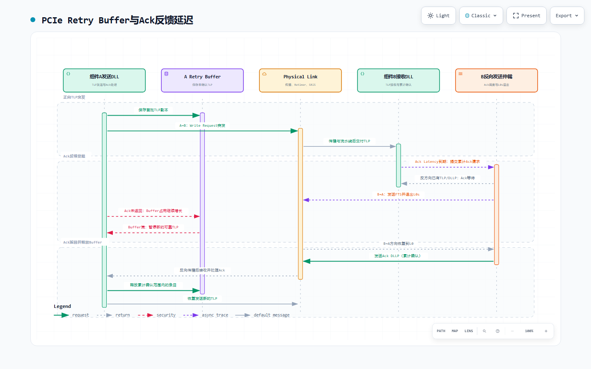

## 1 为什么Retry Buffer会限制发送带宽

在PCIe Non-Flit Mode中，发送端不能在TLP离开Port后立即删除其副本。只有收到能够推进累计确认边界的Ack或Nak后，才能释放Transmit Retry Buffer中的对应条目。

```text
发送TLP
   ↓
副本写入Retry Buffer
   ↓
等待对端返回Ack/Nak
   ↓
释放累计确认范围内的条目
```

如果TLP产生速度高于确认释放速度，未确认数据会持续占用Buffer。当Buffer填满后，即使Flow Control Credit仍然充足，发送端也不能继续接收需要可靠发送的新TLP，否则发生错误时将没有空间保存可重放副本。

因此，合理的设计目标是：

> 在正常运行和满带宽流量下，Transmit Retry Buffer不应因为Ack尚未返回而成为发送节流点。

## 2 容量取决于Ack反馈闭环

Retry Buffer需要容纳Ack反馈返回以前持续发送的全部未确认TLP。可以用下面的关系进行初步估算：

```text
Retry Buffer容量
  ≥ Retry Buffer写入速率 × 最坏正常Ack反馈时间
    + 流水线及实现裕量
```

其中，最坏正常Ack反馈时间至少需要考虑：

| 延迟来源 | 对Buffer的影响 |
| --- | --- |
| Ack Latency | 接收端允许累计多个TLP后再调度Ack |
| 反方向已有TLP或DLLP正在发送 | Ack不能打断已经开始的报文 |
| Physical Link传播与流水线延迟 | TLP到达对端及Ack返回都需要时间 |
| L0s Exit Latency | 反向链路必须先恢复到L0才能发送Ack |
| Ack DLLP接收与处理时间 | 本端解析Ack并释放Buffer存在内部延迟 |
| Retimer延迟 | 每个Retimer都会增加往返路径延迟 |
| SRIS延迟 | 独立参考时钟架构可能增加实现所需的延迟 |



*图2-1：Ack反馈闭环中的主要延迟及Retry Buffer状态变化。正向TLP突发持续占用Buffer；反向Ack依次受到Ack Latency、已有报文、L0s退出和物理路径延迟影响。Ack到达A端并被处理后，累计确认条目被释放，TLP发送恢复。可打开[交互式时序图](/assets/diagrams/pcie-retry-buffer-ack-feedback.html)切换主题、缩放并导出图片。*

这里应使用实际写入Retry Buffer的数据速率，而不是简单把GT/s直接当成Byte/s。链路编码、TLP开销、Lane宽度、内部存储格式以及是否保存完整Data Link封装都会改变Buffer消耗速率。

## 3 设计阶段如何估算最坏Ack反馈延迟

### 3.1 明确测量起点和终点

容量估算关心的是一个Retry Buffer条目实际被占用的最长正常时间。建议统一定义：

```text
起点：最老TLP写入Retry Buffer并进入发送路径
终点：对应累计Ack被本端解析，Retry Buffer条目可以释放
```

如果只测量TLP离开Port到Ack返回Port，会漏掉本端发送流水线和Ack解析流水线；如果又把已经包含在Ack Latency Limit中的对端处理延迟单独加入，则会重复计算。

### 3.2 建立最坏延迟模型

在统一测量边界后，可以将反馈时间拆成：

```text
T_feedback_max =
    T_local_tx_pipeline
  + T_forward_link
  + T_ack_latency_limit
  + T_reverse_blocking
  + T_l0s_exit
  + T_reverse_link
  + T_local_ack_pipeline
  + T_margin
```

| 时间项 | 设计阶段的取值依据 |
| --- | --- |
| `T_local_tx_pipeline` | TLP写入Buffer到最后一个Symbol离开本端Port的最坏周期数 |
| `T_forward_link` | 正向PCB、连接器、线缆、PHY及Retimer延迟 |
| `T_ack_latency_limit` | 当前速率与`Rx_MPS_Limit`对应的规范上限 |
| `T_reverse_blocking` | 反方向已经开始传输的最大TLP或DLLP剩余时间 |
| `T_l0s_exit` | 本端Receiver要求的最大L0s退出时间；不支持L0s时取0 |
| `T_reverse_link` | Ack返回方向的互连、PHY及Retimer延迟 |
| `T_local_ack_pipeline` | Ack进入本端Port到累计释放Buffer的最坏周期数 |
| `T_margin` | CDC、仲裁、PVT及模型不确定性裕量 |

流水线周期必须换算成实际时间：

```text
T_pipeline = Worst_Case_Cycles / Minimum_Operating_Frequency
```

链路传播时间则按支持的最大物理拓扑估算，而不是由LTSSM训练得到。链路训练可以确定运行速度和宽度，但不会给Data Link Layer提供精确的往返延迟测量值。

### 3.3 对所有支持配置取最大值

应建立Speed、Width、MPS、L0s、Extended Synch、Retimer数量和参考时钟模式的配置矩阵，分别计算`T_feedback_max`。不同配置的最坏项不一定相同：高速宽链路具有更大的Buffer写入速率，带Retimer或较长L0s退出的配置则具有更长反馈时间。

最终容量不能只选择最大延迟对应的配置，而应比较每种配置产生的未确认数据量：

```text
B_required(config)
  = R_retry_write(config) × T_feedback_max(config)
    + B_pipeline(config)
    + B_margin(config)

B_final = max(B_required(config))
```

同时还要独立检查短TLP流量需要的条目数量，避免SRAM字节容量尚未耗尽，但Entry或描述符已经用完。

### 3.4 用最坏正常场景验证

性能模型或RTL仿真应组合满带宽TLP、Ack达到允许上限、反向最大报文阻塞、最坏L0s退出、最大Retimer数量、SRIS以及Ack处理排队。验证目标是在这些正常允许条件下Buffer不会溢出，`almost_full`也能在内部在途TLP到达前及时停止新的发送请求。

## 4 为什么本端Receiver的L0s退出延迟会影响本端Transmit Retry Buffer

这一关系容易被误解。组件A向组件B发送TLP时，Ack沿相反方向从B返回A。因此A的Transmit Retry Buffer释放速度，取决于B到A方向何时能够恢复传输；而该方向的L0s退出时间又受到A端Receiver恢复能力的影响。

```text
A Transmitter ─────── TLP ───────→ B Receiver
A Receiver    ←────── Ack ──────── B Transmitter
```

典型过程如下：

1. A的Transmit方向退出L0s，开始连续向B发送较长的Write Request突发。
2. B准备返回Ack，因此启动B到A方向的L0s退出。
3. A的Receiver需要较长时间才能恢复同步，B暂时无法向A发送Ack。
4. A继续发送TLP并占用Retry Buffer，最终可能因为Buffer填满而暂停。
5. B到A方向回到L0后，B发送Ack；A释放已确认条目，发送恢复。

```text
A发送突发 ──────────────────────────────────────→

B→A仍在退出L0s       Ack无法发送
|--------------------------|

A Retry Buffer：持续写入 → 接近满 → Stall
                                  ↓
                            收到Ack并释放
```

因此，A的Transmit Retry Buffer容量需要与A自身Receiver要求的L0s Exit Latency匹配。也可以反向设计：先确定允许实现的Retry Buffer容量，再限制Receiver的L0s退出延迟。

> **question：BTx如何知道ARx已经退出L0s？**
>
> 在链路训练时，双方对各自从L0s退出到L0所需要的最大延迟有估计值，也即ATx发送完固定数目的FTS给BRx后，就可以确定BRx从L0s退出到L0状态。

## 5 两种匹配方法

### 5.1 根据接收恢复延迟确定Buffer

如果Receiver的L0s退出时间已经确定，则将这段时间加入Ack反馈最坏延迟，再计算满带宽期间可能产生的未确认数据量：

```text
T_feedback = T_ack_latency
           + T_reverse_blocking
           + T_link_round_trip
           + T_l0s_exit
           + T_ack_processing
           + T_retimer_sris

B_retry ≥ R_retry_write × T_feedback + Margin
```

### 5.2 根据Buffer预算限制退出延迟

如果芯片面积或功耗先限定了Retry Buffer容量，则可以反推出允许的最大反馈延迟：

```text
T_feedback_max ≤ (B_retry - Margin) / R_retry_write
```

扣除Ack Latency、传播、阻塞和处理时间后，剩余预算才是Receiver L0s退出、Retimer和SRIS可以占用的延迟。

## 6 Ack Latency Limit解决什么问题

如果接收端可以无限延迟Ack，发送端就只能提供无限大的Retry Buffer。协议规定Ack Latency Limit，是为了给发送端建立一个有限且可设计的未确认数据上界。

Ack Latency Limit需要在两方面折中：

- Ack过于频繁会增加DLLP开销，降低有效链路带宽。
- Ack允许延迟过长会要求更大的Retry Buffer，增加面积和功耗。

规范对所有组件采用一致要求，而不会根据某个设备属于消费电子、服务器或嵌入式应用而改变协议限制。这样，不同厂商和用途的组件连接后才能获得可预期的通用互操作性能。

## 7 Buffer较小是否违反协议

如果组件不需要持续使用Link的全部发送带宽，可以采用小于“保证满带宽永不因Retry Buffer而停顿”所需容量的Buffer。

这种实现可以保持协议正确，但会降低性能：

```text
Retry Buffer接近满
        ↓
暂停接收或调度新的Transaction Layer TLP
        ↓
等待Ack释放空间
        ↓
继续发送
```

不能做的是在Buffer已满时继续发送新的可靠TLP却不保存可重放副本。发生Nak或Replay Timeout时无法恢复原始TLP，会破坏Data Link Layer可靠性。

因此应区分：

- **功能下限**：能够保存所有已经发送但尚未确认的TLP，保证可Replay。
- **性能目标**：在正常最坏Ack延迟和目标流量下不因Buffer已满而节流。

## 8 为什么12-bit Sequence Number范围不会先成为瓶颈

Non-Flit Mode使用12-bit TLP Sequence Number，并通过半个序号空间限制合法的未确认窗口。规范选择的Ack Latency Limit能够保证正常合规实现不会在Ack返回前耗尽允许使用的Outstanding Sequence Number范围。

因此，容量设计时通常先遇到的是Retry Buffer字节数、条目数或内部处理带宽限制，而不是12-bit Sequence Number本身耗尽。实现仍必须正确处理序号回卷，但不应依靠序号空间代替Buffer容量分析。

## 9 Retimer和SRIS为什么需要额外裕量

Retimer会终结并重新建立Physical Layer信号，但不终结Data Link Layer Retry协议。TLP及其Ack仍然属于原来两个Port之间的同一数据链路闭环，因此Retimer增加的传播和处理延迟会延长Retry Buffer条目的驻留时间。

SRIS（Separate Refclk Independent SSC）允许链路两端使用独立参考时钟，需要通过接收侧弹性与时钟补偿机制处理频率差异，也可能增加数据路径延迟。

规范强烈建议在最优Buffer容量评估中考虑这些影响。工程上应按支持的最坏拓扑计算，而不是只使用无Retimer、公共参考时钟实验环境中的最短延迟。

## 10 实现检查清单

- 明确Retry Buffer保存的是完整封装副本，还是TLP、Sequence Number及重建LCRC所需信息。
- 分别计算Buffer的Byte容量、条目数量和读写带宽。
- 使用目标Link宽度与实际有效数据率估算满带宽写入速度。
- 加入Ack Latency、当前反向报文阻塞、链路往返与Ack处理延迟。
- 加入Receiver L0s Exit Latency以及Extended Synch可能造成的影响。
- 按最大支持Retimer数量和SRIS模式增加裕量。
- 验证Retry Buffer满时能够安全停止接收新的发送请求。
- 验证Ack累计释放、Nak Replay和Sequence Number回卷期间的指针行为。

## 11 总结

Transmit Retry Buffer本质上保存的是Ack反馈闭环中的在途数据。它的合理容量不只由正向TLP带宽决定，还取决于Ack Latency、反向链路阻塞、本端Receiver的L0s退出时间、物理传播、Ack处理、Retimer和SRIS延迟。

最关键的设计关系是：

```text
更长的Ack反馈时间 → 更多未确认TLP → 更大的Retry Buffer
```

如果系统不要求满带宽，较小Buffer可以通过发送停顿换取面积；如果目标是在正常条件下持续满速，则必须让Buffer容量与最坏正常Ack反馈时间相匹配。

## 12 参考资料

- PCI Express Base Specification Revision 7.0：Transmit Retry Buffer与Ack Latency相关章节。
- PCI Express Base Specification Revision 7.0：L0s、Retimer及SRIS相关章节。
