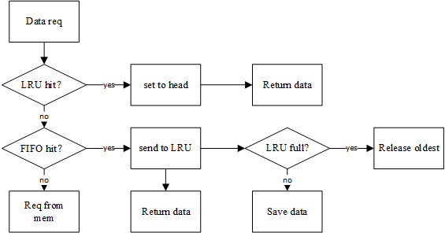

## what does LRU work for
本质上维护一系列最有可能会被再次使用的数据备份，并通过一系列策略写入并释放其中的数据

## how does LRU work
整个模块可以抽象为：



核心流程可以分为两大流程：

- 缓存查询
- 缓存更新

首先是缓存查询，需要将请求数据与已有缓存数据进行匹配。如果命中则直接返回，否则需要从mem中请求。

缓存的意义就在这，采用额外面积来缓存常用的数据，避免频繁访问高延迟大容量存储，提高整体运行速率。

## 查询如何实现
查询的目的是为了确认是否已有缓存，避免重复向mem请求
考虑到延迟，时序允许情况下最好单周期完成
在实现上，可以等效为所有entry并行独立完成比较

1. 直接比较

``` verilog
module  cache_hit_chk
#(
    parameter       POOL_DEPTH  =   128     ,
    parameter       AWID_WIDTH  =   16      
)
(
    input   logic   clk                     ,
    input   logic   rst_n                   ,

    input   logic   chk_awid                ,
    input   logic   chk_req                 ,
);

// cache for exist awid
logic       [AWID_WIDTH -1:0]   mem_awid    [POOL_DEPTH -1:0]   ;
// bitmap for cache hit
logic       [POOL_DEPTH -1:0]   hit_bitmap                      ;

// better timing but 1 cycle delay
always_ff @(posedge clk, negedge rst_n) begin
    if(!rst_n)  begin
        // set 0 to escape error match
        for(integer i;i<POOL_DEPTH-1;i=i+1) begin
            hit_bitmap[i] <= 1'b0;
        end
    end
    else if(chk_req)    begin   // icg
        // each entry chk itself parallize
        for(integer i;i<POOL_DEPTH-1;i=i+1) begin
            if(mem_awid[i] == chk_awid)
                hit_bitmap[i] <= 1'b1;
        end
    end
end

// no delay but poor timing & higher power
always_comb begin
    hit_bitmap <= 'b0;
    // each entry chk itself parallize
    for(integer i;i<POOL_DEPTH-1;i=i+1) begin
        if(mem_awid[i] == chk_awid)
            hit_bitmap[i] <= 1'b1;
    end
end
```

2. tag match

直接进行匹配在大位宽awid情况下会导致高扇出，所以时序很难优化
可以先将大位宽 AWID 压缩为低位宽哈希值，通过哈希比较筛选候选项，再对候选项进行完整 AWID 比较，以排除哈希碰撞造成的误命中


